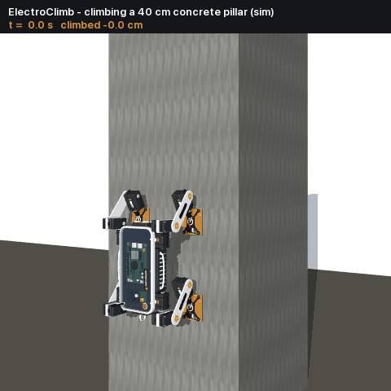

# ElectroClimb

**An open-source legged robot that climbs concrete, glass and wood using electroadhesive feet, controlled by reinforcement learning, and inspects structures as it goes.**

> Status: stage 1 (foot hardware) in progress, and the simulated robot already climbs a vertical wall. See [`hardware/foot/`](hardware/foot/) and [`sim/`](sim/).

  
  

<em>MuJoCo simulation, vertical wall and a 40 cm concrete pillar, 2× speed: baseline crawl gait with electroadhesive feet, 18 cm in 20 s without falling. Real physics, not an animation.</em>

## Repository

| Path | What's there |
|---|---|
| [`hardware/foot/`](hardware/foot/) | Stage 1 foot design spec, pad footprints (KiCad), previews, BOM |
| [`tools/gen_electrode.py`](tools/gen_electrode.py) | Parametric electrode pad generator (`--selftest` checks for shorts) |
| [`tools/driver_calc.py`](tools/driver_calc.py) | HV driver component values + design-rule checks |
| [`sim/`](sim/) | MuJoCo model, climbing environment, crawl gait, physics checks, media renderer (stage 2) |
| [`media/`](media/) | Simulation GIFs and images (rendered by `sim/render_media.py`) |
| [`docs/`](docs/) | Sponsorship sheet |

## Why

Every bridge, dam, tower and facade needs regular inspection. Today that means scaffolding, rope access or drones that can't touch the surface. A robot that walks up the wall itself can get close enough to measure a crack, tap the concrete and come back down.

Climbing robots with learned controllers already exist, but they cling to **steel** with magnets. Most of the built world is concrete, glass, brick and wood, where magnets don't work.

**Electroadhesion** works on almost any surface. A thin pad with interdigitated electrodes at 1–3 kV (microamp current) induces charge in the surface and sticks to it, then releases instantly when switched off. The hard part is that adhesion depends on the surface, dust, humidity and how flat the contact is, and one bad step means a fall.

ElectroClimb treats that as a learning problem. Each foot senses its own grip through electrode capacitance, and a reinforcement learning policy decides where to step, how hard to press, when to energise each foot and when to peel it off.

## What makes it new

| | Existing learned climbers | ElectroClimb |
|---|---|---|
| Adhesion | Magnets (steel only) | Electroadhesion (concrete, glass, wood, painted walls) |
| Grip sensing | Assumed or estimated | Measured per foot (electrode capacitance) |
| Control | RL for walking, fixed adhesion | RL controls walking **and** adhesion (voltage, timing, peel) |
| Openness | Closed, research hardware | Fully open hardware, firmware, simulation, policies |
| Cost target | Lab robots | Under €2,000 in parts |

## The robot

- **Body:** quadruped, about 40 cm and under 1.5 kg, with a 3D-printed carbon-fibre-nylon frame.
- **Legs:** 3 actuated joints per leg (12 total), using low-cost smart servos at first and custom quasi-direct-drive actuators in v2.
- **Feet:** flexible-PCB electroadhesive pads (polyimide doubles as the insulator) on compliant TPU backings, with a passive ankle so each pad can lie flat.
- **Foot electronics:** one small high-voltage driver per foot (boost converter plus multiplier, current-limited), and a capacitance-sensing front end on the same electrodes for grip and contact sensing.
- **Compute:** Seeed XIAO microcontrollers per leg on a CAN bus, and a Raspberry Pi 5 or Jetson Orin Nano running the policy and vision.
- **Sensing:** IMU, joint encoders and currents, per-foot capacitance, front stereo camera.
- **Safety:** tether line during development, fall detection, and a hardware interlock so the high voltage is only on when the foot is in contact.

## The learning

1. **Adhesion model:** measure holding force against voltage, surface, dust, humidity and peel angle on a test rig. Fit a stochastic adhesion model to that data.
2. **Simulation:** model the robot in MuJoCo / Isaac Lab with the learned adhesion model, including random attachment failures, surface patches and dust.
3. **Curriculum RL:** train on thousands of parallel simulated environments while slowly tilting gravity from floor to vertical wall to overhang. Domain randomisation covers adhesion, friction, motor strength, latency and sensor noise.
4. **Teacher-student:** a teacher policy that sees true adhesion trains a student policy that only sees what the real robot senses (capacitance, IMU, joints).
5. **Sim-to-real:** deploy on the robot, tethered, first on a tilting test wall, then vertical, then real structures.
6. **Inspection:** an onboard vision model detects cracks and spalling, and the robot builds a 3D map of the wall with defects marked.

## Roadmap

| Stage | Goal | Done when |
|---|---|---|
| **1. Electroadhesive foot** (months 1–3) | Pad design, high-voltage driver, capacitance sensing, adhesion test rig | Reliable hold on concrete, glass and wood, and grip measured from capacitance |
| **2. Adhesion model + simulation** (months 2–5) | Data-driven adhesion model, robot simulation, first trained climbing policy in sim | A policy climbs a vertical wall in simulation and survives random adhesion failures |
| **3. Robot v1** (months 4–7) | Build the quadruped and electronics, and get it walking on the floor | Walks with an RL policy transferred from simulation |
| **4. Real climbing** (months 6–10) | Tilt-wall curriculum on hardware, then vertical | Climbs 2 m of vertical concrete and glass on a tether, without falling |
| **5. Inspection** (months 9–12) | Crack-detection model, mapping, floor-to-wall transitions | Climbs a real wall and returns a map of defects |
| **6. Release** (month 12) | Build guide, datasets, trained policies, paper | Everything open, and a paper submitted (ICRA / IROS / RA-L) |

## Hard problems

- **Adhesion you can't fully see:** grip changes with dust, moisture and micro-texture, so the policy must act on noisy, partial information.
- **Contact dynamics in simulation:** electrostatic adhesion is not built into physics engines, so it has to be modelled and learned from data.
- **High voltage on a moving robot:** insulation, creepage, current limiting and interlocks have to survive vibration and falls.
- **Power and weight:** every gram counts on a vertical wall, while the robot carries compute, batteries and four high-voltage drivers.
- **Transitions:** going from floor to wall and wall to ledge are the hardest manoeuvres in climbing.

## Who it's for

- **Infrastructure owners and inspectors:** close-up inspection without scaffolding.
- **Researchers:** an open platform and benchmark for learned adhesion and climbing.
- **Students:** a full robotics stack covering hardware, embedded, simulation, RL, vision and safety.

## License

Hardware: CERN-OHL-S v2. Software, firmware and models: MIT.

## Author

Aghasalim Mustafazada, Creative Technologies & AI, Howest University of Applied Sciences (Belgium)
Previous project: [smart-ivc-cage-platform](https://github.com/aghasalim/smart-ivc-cage-platform)

## Related work

- Um et al., *Reinforcement Learning-based Robust Wall Climbing Locomotion Controller in Ferromagnetic Environment*, arXiv:2510.20174 (2025). Magnetic feet on steel.
- *Magnecko: Design and Control of a Quadrupedal Magnetic Climbing Robot*, arXiv:2504.13672 (2025).
- Hemsing, *electrostatic-adhesion-plate*, open-source electroadhesion PCB (CERN-OHL-S).
