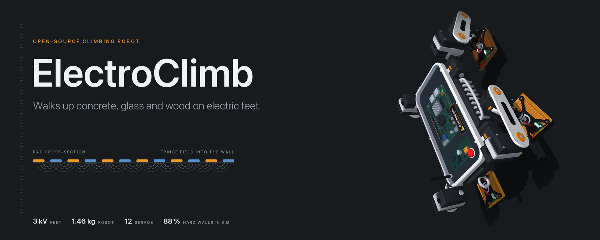
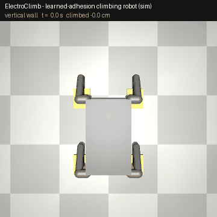
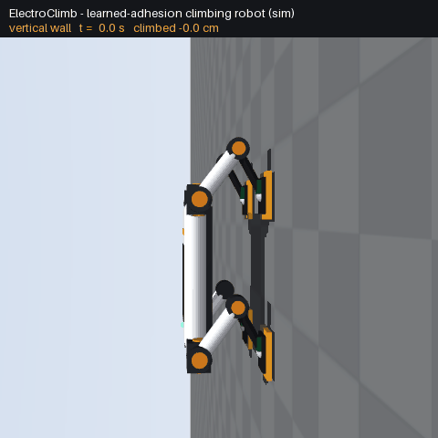
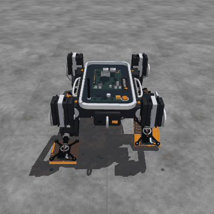
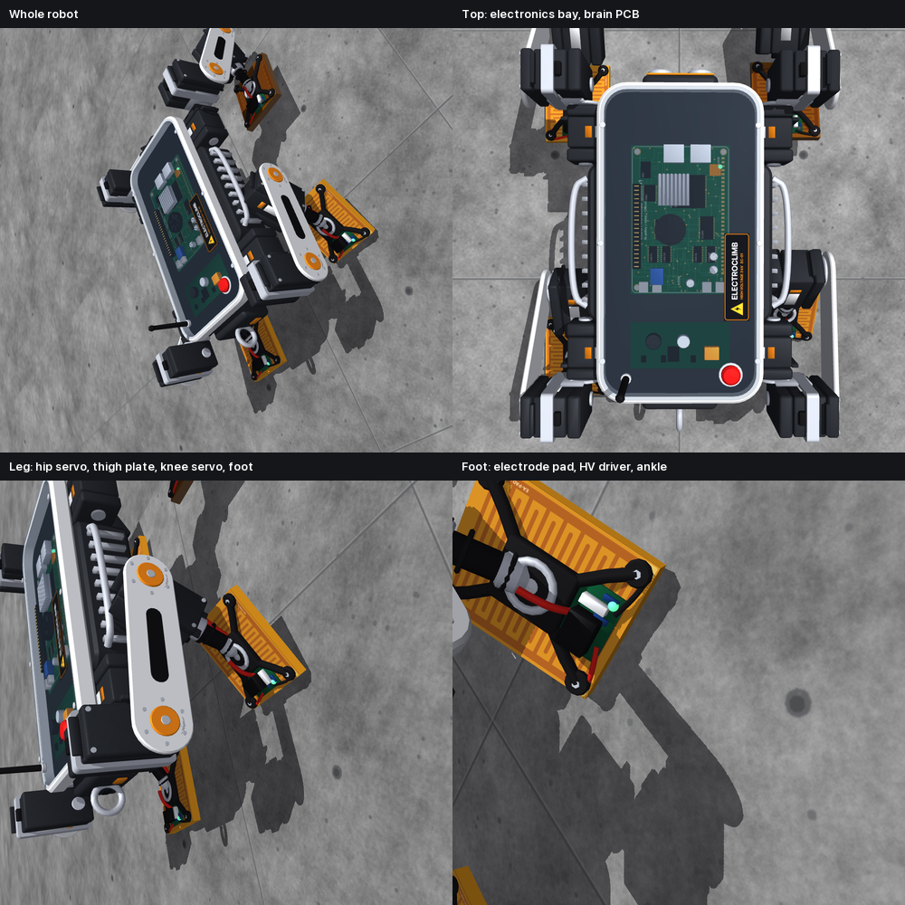
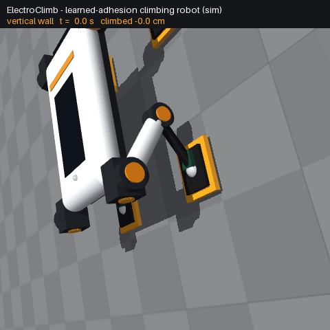
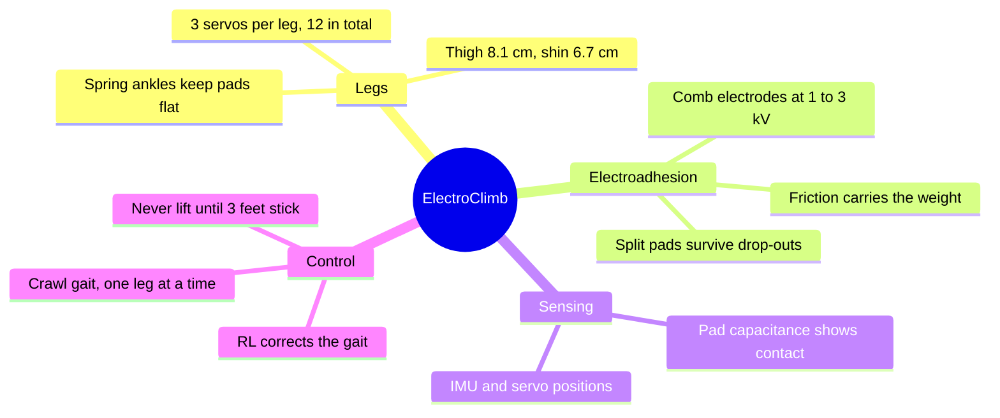
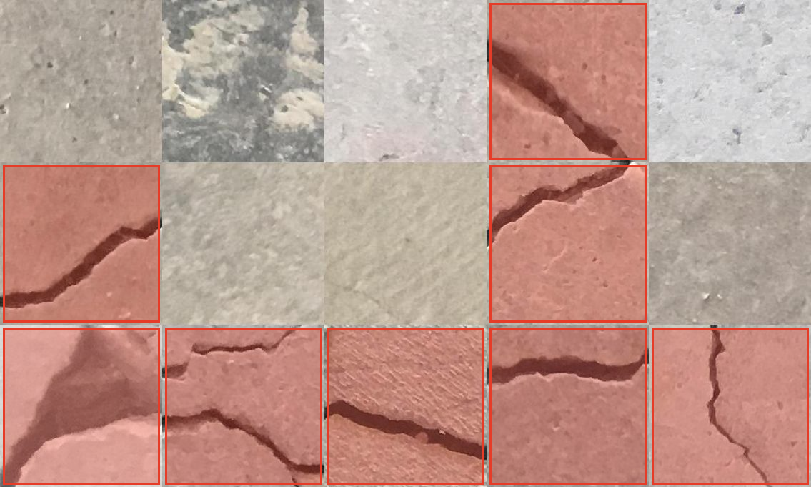
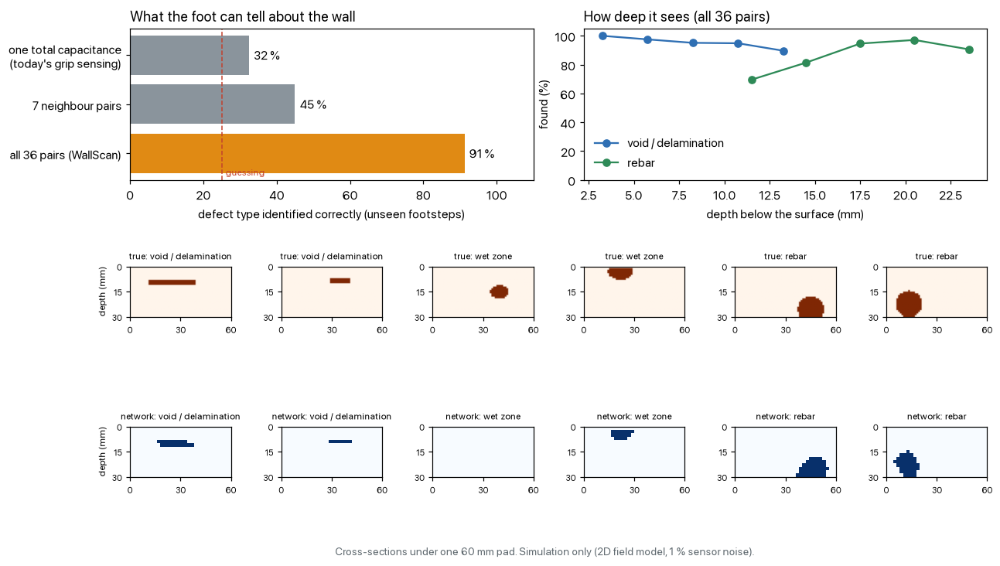

<h1 align="center">ElectroClimb</h1>

<strong>An open-source legged robot that climbs concrete, glass and wood on electroadhesive feet, controlled by reinforcement learning, and inspects structures as it goes.</strong>

  
  
  
  
  

  <a href="docs/HOW_IT_WORKS.md">How it works</a> ·
  <a href="#the-model">The model</a> ·
  <a href="#ai-in-electroclimb">AI</a> ·
  <a href="docs/WALLSCAN.md">WallScan</a> ·
  <a href="hardware/foot/BUILD.md">Build a foot</a> ·
  <a href="sim/README.md">Simulation</a> ·
  <a href="inspection/README.md">Inspection</a> ·
  <a href="#roadmap">Roadmap</a>

> **Status:** everything here runs in simulation. The simulated robot climbs a vertical wall; the foot hardware (stage 1) is in progress. See [`hardware/foot/`](hardware/foot/) and [`sim/`](sim/).

  
  

<em>MuJoCo simulation, vertical wall and a 40 cm concrete pillar, 2× speed: baseline crawl gait with electroadhesive feet, 18 cm in 20 s without falling. Real physics, not an animation.</em>

## The model

  

| Part | What's modelled |
|---|---|
| **Motors** | 12 STS3215 servos (45.2 × 24.7 × 35 mm) in their mounting positions: 4 abduction servos in the chassis corners, 4 hip servos bolted to their horns, 4 knee servos built into the shins. Horns, case screws, mounting ears and cable exits included. |
| **Legs** | One outboard thigh plate per leg between the hip horn and the knee horn, a carbon shin tube, a ball ankle and the red high-voltage cable down each shin. |
| **Feet** | Flex-PCB pad with the two interdigitated copper combs, a TPU spider, and the HV driver board (HV module, reed relay, resistors, LED). Pads and LEDs glow while energised. |
| **Brain** | Electronics bay under a clear lid: brain PCB (CPU with heat sink and fan, RAM, flash, 4 CAN transceivers, IMU, GPIO header, leg connectors) and a power board. |
| **Enclosure** | Graphite chassis tub with cooling fins and grab rails, white bay rim, stereo camera nose with an inspection light, tail block with tether ring, antenna, e-stop and charge port, battery strapped under the belly. |

The whole model is generated by [`sim/make_assets.py`](sim/make_assets.py) (70 meshes, 36,000 triangles, 4 textures). It is visual only: the detailed parts have no mass and no contacts, so mass (1.46 kg), inertia and every simulation result are unchanged. It shows the intended layout; it is not a CAD model for manufacturing. The first real CAD is the foot: [`hardware/foot/cad/`](hardware/foot/cad/).

## Repository

| Path | What's there |
|---|---|
| [`hardware/foot/`](hardware/foot/) | Stage 1 foot: design spec, pad footprints (KiCad), BOM, **real CAD (STEP/STL)** and a [build guide](hardware/foot/BUILD.md) |
| [`tools/gen_electrode.py`](tools/gen_electrode.py) | Parametric electrode pad generator (`--selftest` checks for shorts) |
| [`tools/driver_calc.py`](tools/driver_calc.py) | HV driver component values + design-rule checks |
| [`sim/`](sim/) | MuJoCo model, climbing environment, crawl gait, physics checks, media renderer (stage 2) |
| [`inspection/`](inspection/) | Crack-detection CNN, RAG inspection assistant, LLM mission planner (stage 5) |
| [`sensing/`](sensing/) | WallScan: field solver and network for sensing inside the wall with the pad electrodes (simulation study) |
| [`media/`](media/) | Simulation GIFs and images (rendered by `sim/render_media.py`) |
| [`docs/HOW_IT_WORKS.md`](docs/HOW_IT_WORKS.md) | How it works: leg mechanism, gait, electroadhesion physics, peel moment, HV driver, RL loop, results |
| [`docs/DESIGN.md`](docs/DESIGN.md), [`docs/LAUNCH_POSTS.md`](docs/LAUNCH_POSTS.md) | Visual language of the banner and images; draft launch posts |
| [`docs/`](docs/) | Sponsorship sheet |

## Why

Every bridge, dam, tower and facade needs regular inspection. Today that means scaffolding, rope access or drones that can't touch the surface. A robot that walks up the wall itself can get close enough to measure a crack, tap the concrete and come back down.

Climbing robots with learned controllers already exist, but they cling to **steel** with magnets. Most of the built world is concrete, glass, brick and wood, where magnets don't work.

**Electroadhesion** works on almost any surface. A thin pad with interdigitated electrodes at 1–3 kV (microamp current) induces charge in the surface and sticks to it, then releases instantly when switched off. The hard part is that adhesion depends on the surface, dust, humidity and how flat the contact is, and one bad step means a fall.

ElectroClimb treats that as a learning problem. Each foot senses its own grip through electrode capacitance, and a reinforcement learning policy decides where to step, how hard to press, when to energise each foot and when to peel it off.

## What makes it new

| | Existing learned climbers | ElectroClimb |
|---|---|---|
| Adhesion | Magnets (steel only) | Electroadhesion (concrete, glass, wood, painted walls) |
| Grip sensing | Assumed or estimated | Measured per foot (electrode capacitance) |
| Control | RL for walking, fixed adhesion | RL controls walking **and** adhesion (voltage, timing, peel) |
| Openness | Closed, research hardware | Fully open hardware, firmware, simulation, policies |
| Cost target | Lab robots | Under €2,000 in parts |

## How it works

  

<em>One leg stepping: the pad lets go, the foot lifts 2.5 cm, moves 4 cm up and sticks again.</em>

- **Legs:** each leg has hip abduction, hip flexion and knee servos (Feetech STS3215). Inverse kinematics turns planned foot positions into joint angles. On a vertical wall the gait needs at most 0.9 N·m per joint.
- **Gait:** one foot moves at a time (release, lift, swing 4 cm, place until contact, stick), then the body pulls itself up on all four pads. A foot is only released when the other three report contact.
- **Physics:** the pads press the robot against the wall and friction carries the weight: 0.6 × pads × 15 N × grip must beat 14.3 N. With three pads that needs at least 53 % grip. The weight 9 cm from the wall also tries to peel the upper feet off (about 6.4 N), which is why the body crouches low.
- **Electronics:** each pad half has its own high-voltage driver (XP Power AG30P-5, 0–3 kV, microamp-limited), a 1 GΩ safety bleeder and a reed relay that releases the pad in about 1 ms.

**Full explanation with diagrams: [docs/HOW_IT_WORKS.md](docs/HOW_IT_WORKS.md).**

### Latest simulation results

Success = no fall and at least 10 cm climbed in 20 s on 40 hard vertical test walls.

| | Success | Falls |
|---|---|---|
| Crawl gait, one-piece pads | 80 % | 15 % |
| Best RL policy, one-piece pads | 82 % | 12 % |
| **Crawl gait, split pads** | **88 %** | **12 %** |
| RL policy, split pads | 88 % | 12 % |
| Crawl gait, split pads, +10 % pad force | **95 %** | **2 %** |

Splitting each pad into two independently driven halves fixes random pad drop-outs. The rest is a margin question: about 10 % more pad force (bigger pads or a lighter robot) takes the plain gait to 95 %. Details in [`sim/README.md`](sim/README.md).

## AI in ElectroClimb

| Part | Method | Result | Code |
|---|---|---|---|
| Climbing control | Residual RL on a crawl gait: PPO, SAC, curriculum, teacher-student distillation (DAgger) | 88 % on 40 hard walls; 95 % with 10 % more pad force | [`sim/`](sim/README.md) |
| Crack detection | CNN on 40,000 concrete photos, tile scan of wall images | 99.25 % on 4,000 unseen photos | [`inspection/crack_model.py`](inspection/crack_model.py) |
| Inspection assistant | RAG: BM25 over the FHWA Bridge Inspector's Reference Manual + Claude with page citations | answers and defect reports cite manual pages | [`inspection/rag.py`](inspection/rag.py) |
| Subsurface sensing (WallScan) | Finite-difference field model + neural inverse on 36 electrode-pair capacitances | 91 % defect identification in simulation; untested on hardware | [`sensing/wallscan.py`](sensing/wallscan.py) |
| Mission planning | LLM (Claude) turns a sentence into a checked waypoint plan the robot climbs in simulation | holds within 0.03 cm at each inspection stop | [`inspection/mission.py`](inspection/mission.py) |

Details: [`inspection/README.md`](inspection/README.md) and [`sim/README.md`](sim/README.md).

## New idea: WallScan, feet that see inside the wall

The pads that hold the robot could also scan the wall. With each pad's comb split into 8 separately wired strips, the 36 strip-pair capacitances carry information about what is under the foot. In a first simulation study, a neural network identifies voids, wet zones and rebar correctly in **91 %** of unseen footsteps and locates them within 2.4 mm sideways and 1.1 mm in depth; one capacitance per pad (today's grip sensing) manages 32 %. In a literature search, no published climbing robot was found that uses its adhesion electrodes to image the wall. This is simulation only, not yet measured on hardware. Details, sources and limits: [`docs/WALLSCAN.md`](docs/WALLSCAN.md).

## The robot

- **Body:** quadruped, about 40 cm and under 1.5 kg, with a 3D-printed carbon-fibre-nylon frame.
- **Legs:** 3 actuated joints per leg (12 total), using low-cost smart servos at first and custom quasi-direct-drive actuators in v2.
- **Feet:** flexible-PCB electroadhesive pads (polyimide doubles as the insulator) on compliant TPU backings, with a passive ankle so each pad can lie flat.
- **Foot electronics:** a small high-voltage driver per pad half (two per foot, so one fault only loses half a pad), current-limited, and a capacitance-sensing front end on the same electrodes for grip and contact sensing.
- **Compute:** Seeed XIAO microcontrollers per leg on a CAN bus, and a Raspberry Pi 5 or Jetson Orin Nano running the policy and vision.
- **Sensing:** IMU, joint encoders and currents, per-foot capacitance, front stereo camera.
- **Safety:** tether line during development, fall detection, and a hardware interlock so the high voltage is only on when the foot is in contact.

## The learning

1. **Adhesion model:** measure holding force against voltage, surface, dust, humidity and peel angle on a test rig. Fit a stochastic adhesion model to that data.
2. **Simulation:** model the robot in MuJoCo / Isaac Lab with the learned adhesion model, including random attachment failures, surface patches and dust.
3. **Curriculum RL:** train on thousands of parallel simulated environments while slowly tilting gravity from floor to vertical wall to overhang. Domain randomisation covers adhesion, friction, motor strength, latency and sensor noise.
4. **Teacher-student:** a teacher policy that sees true adhesion trains a student policy that only sees what the real robot senses (capacitance, IMU, joints).
5. **Sim-to-real:** deploy on the robot, tethered, first on a tilting test wall, then vertical, then real structures.
6. **Inspection:** an onboard vision model detects cracks and spalling, and the robot builds a 3D map of the wall with defects marked.

## Roadmap

| Stage | Goal | Done when |
|---|---|---|
| **1. Electroadhesive foot** (months 1–3) | Pad design, high-voltage driver, capacitance sensing, adhesion test rig | Reliable hold on concrete, glass and wood, and grip measured from capacitance |
| **2. Adhesion model + simulation** (months 2–5) | Data-driven adhesion model, robot simulation, first trained climbing policy in sim | A policy climbs a vertical wall in simulation and survives random adhesion failures |
| **3. Robot v1** (months 4–7) | Build the quadruped and electronics, and get it walking on the floor | Walks with an RL policy transferred from simulation |
| **4. Real climbing** (months 6–10) | Tilt-wall curriculum on hardware, then vertical | Climbs 2 m of vertical concrete and glass on a tether, without falling |
| **5. Inspection** (months 9–12) | Crack-detection model, mapping, floor-to-wall transitions | Climbs a real wall and returns a map of defects |
| **6. Release** (month 12) | Build guide, datasets, trained policies, paper | Everything open, and a paper submitted (ICRA / IROS / RA-L) |

## Hard problems

- **Adhesion you can't fully see:** grip changes with dust, moisture and micro-texture, so the policy must act on noisy, partial information.
- **Contact dynamics in simulation:** electrostatic adhesion is not built into physics engines, so it has to be modelled and learned from data.
- **High voltage on a moving robot:** insulation, creepage, current limiting and interlocks have to survive vibration and falls.
- **Power and weight:** every gram counts on a vertical wall, while the robot carries compute, batteries and four high-voltage drivers.
- **Transitions:** going from floor to wall and wall to ledge are the hardest manoeuvres in climbing.

## Who it's for

- **Infrastructure owners and inspectors:** close-up inspection without scaffolding.
- **Researchers:** an open platform and benchmark for learned adhesion and climbing.
- **Students:** a full robotics stack covering hardware, embedded, simulation, RL, vision and safety.

## License

Hardware: CERN-OHL-S v2. Software, firmware and models: MIT.

## Author

Aghasalim Mustafazada, Creative Technologies & AI, Howest University of Applied Sciences (Belgium)
Previous project: [smart-ivc-cage-platform](https://github.com/aghasalim/smart-ivc-cage-platform)

## Related work

- Um et al., *Reinforcement Learning-based Robust Wall Climbing Locomotion Controller in Ferromagnetic Environment*, arXiv:2510.20174 (2025). Magnetic feet on steel.
- *Magnecko: Design and Control of a Quadrupedal Magnetic Climbing Robot*, arXiv:2504.13672 (2025).
- Hemsing, *electrostatic-adhesion-plate*, open-source electroadhesion PCB (CERN-OHL-S).
