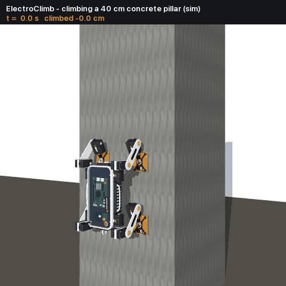
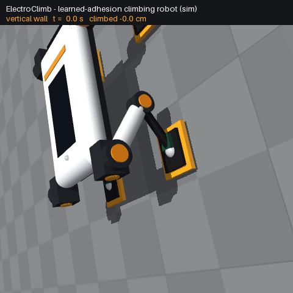
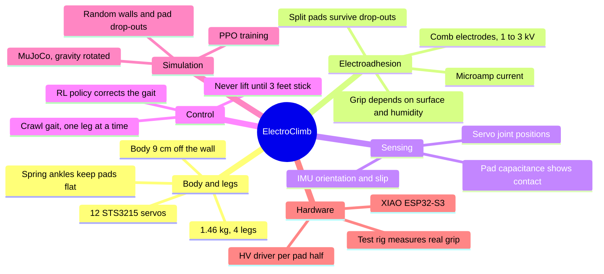
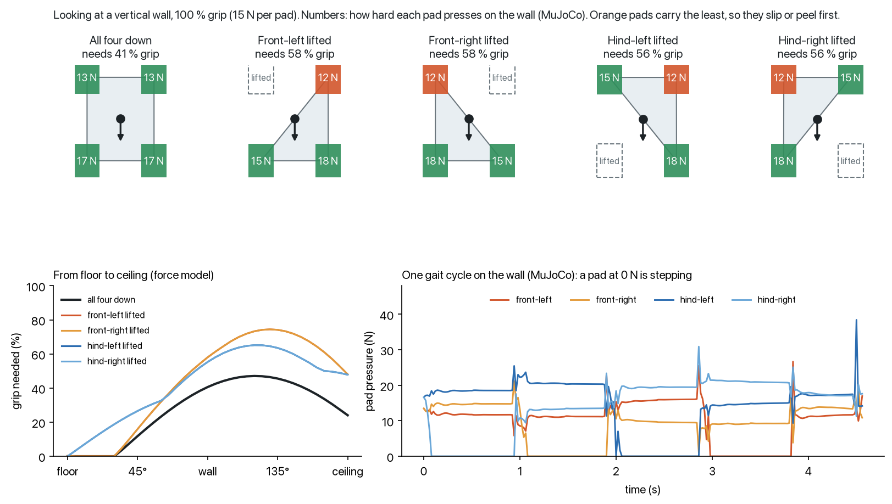
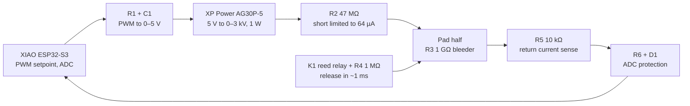
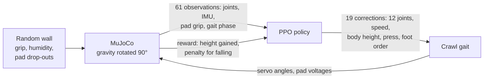

# How ElectroClimb works

A 1.46 kg four-legged robot that sticks to concrete, glass and wood with high-voltage pads. Every number here comes from the MuJoCo model ([`sim/electroclimb.xml`](../sim/electroclimb.xml)), the gait ([`sim/crawl_gait.py`](../sim/crawl_gait.py)) and the foot design ([`hardware/foot/`](../hardware/foot/)).

<p align="center">
  
  
</p>

## The whole system



## Leg mechanism

Each leg has **three servos** (Feetech STS3215):

| Joint | Axis | Range | What it does |
|---|---|---|---|
| Hip abduction | along the body | ±30° | swings the leg sideways |
| Hip flexion | across the body | ±90° | swings the leg up and down the wall |
| Knee | across the body | 0–150° | bends the leg towards the wall |

- **Thigh** 8.1 cm, **shin** 6.7 cm. Standing pose: hip −0.4 rad, knee 1.0 rad, which puts the body about 9 cm off the wall.
- Below the knee sit **two passive spring joints** (±20°, stiffness 6) so the pad can tilt to meet the wall. The pad is pre-rotated so the springs hold it **flat** in the standing pose. In the first version they held it tilted, only the pad edge touched, and the robot slid off.
- The gait plans each foot's position in the body frame. Inverse kinematics (damped least squares on a copy of the MuJoCo model) turns that into hip and knee angles, so the planner always matches the model.
- On a vertical wall the gait needs at most **0.9 N·m** per joint. The STS3215 gives 1.9 N·m at 7.4 V and about 2.9 N·m at 12 V. With the joint torque limited to 1.4 N·m in simulation, the robot still climbs the same 18 cm.

## Crawl gait

Only one foot is off the wall at a time, so three pads always hold the body. Order: hind-right, front-right, hind-left, front-left.

| Phase | Time | What happens |
|---|---|---|
| Release | 0.10 s | pad voltage ramps to zero |
| Lift | 0.15 s | foot rises 2.5 cm |
| Swing | 0.25 s | foot moves 4 cm up the wall |
| Place | 0.25 s | foot reaches down until the pad senses contact |
| Stick | 0.15 s | voltage ramps back up |

After all four steps the body pulls itself 4 cm up on four stuck pads (0.8 s). One cycle takes 4.4 s.

**Safety rule:** never release a foot until every other foot reports contact. Until then the gait waits and presses the missing foot down. Without this rule the robot fell off.

```mermaid
stateDiagram-v2
  direction LR
  [*] --> Check
  Check --> Release: other 3 feet touch
  Check --> Press: a foot is missing
  Press --> Check
  Release --> Lift --> Swing --> Place
  Place --> Place: no contact yet, reach further
  Place --> Stick: pad senses the wall
  Stick --> Check: next leg
  Stick --> PullUp: all 4 legs stepped
  PullUp --> Check
```

## How a pad sticks (electroadhesion)

The pad is a flexible circuit board with **comb-shaped electrodes** that interlock like fingers, under a polyimide insulator. At 1–3 kV neighbouring fingers have opposite charge. The fringing field reaches into the wall and pulls charges in the surface towards the pad, so pad and wall attract.

```
   +   −   +   −   +   −      electrodes, 1–3 kV
  ═══════════════════════     polyimide insulator
  ╰─╯ ╰─╯ ╰─╯ ╰─╯ ╰─╯         field lines into the wall
   −   +   −   +   −   +      induced charges in the wall
```

The holding pressure is roughly P ≈ ½ · ε₀ · εᵣ · E², so it grows with the square of the field: double the voltage, about four times the grip. The current is microamps, so holding costs almost no power.

- **Works on almost anything:** concrete, glass, wood, painted walls. Magnets only work on steel.
- **Grip varies** with surface roughness, dust, humidity and how flat the pad lies. The simulation randomises this per wall.
- **Sensing for free:** the electrodes are also a capacitor. Contact makes the capacitance jump, so each foot knows when it touches.
- **Fast release:** a reed relay shorts the pad through 1 MΩ, so it lets go in about 1 ms.

## Will it hold?

On a vertical wall the pads press the robot against the wall and **friction carries the weight**:

```
μ · n · F_pad  ≥  m · g
0.6 · n · (15 N × grip)  ≥  1.46 kg × 9.81 = 14.3 N
```

With three pads stuck (one foot stepping) the robot needs at least **53 % grip**. The 15 N per pad is a placeholder until the test rig measures real values.

## Peel moment

The weight acts 9 cm from the wall. That moment tries to peel the upper feet off, like a door hinged at the lower feet:

```
F_peel = m·g · h / L = 14.3 N × 9 cm / 20 cm ≈ 6.4 N
```

This is why the robot crouches. The first design stood 16 cm off the wall and the upper feet kept peeling; at 9 cm the force is almost halved. It is also why lifting an **upper** foot is the riskiest moment of the gait.

## Gravity and balance: standing on three legs

On a floor, a robot balances when its centre of mass is above the triangle of its three standing feet. On a wall that rule no longer works: gravity pulls **along** the surface, so nothing balances by itself and the pads have to do two jobs at once.

<p align="center"></p>

1. **Carry the weight by friction.** Each pad can carry shear up to 0.6 × how hard it presses on the wall.
2. **Stop the body tipping backwards.** The centre of mass sits 7.7 cm off the wall, so the 14.3 N weight is a lever that pulls the upper pads off the wall and pushes the lower pads into it.

Job 2 makes job 1 harder: the pads that are pulled press less on the wall, so they have less friction. With all four pads at 15 N, the upper pads press with 13 N and the lower ones with 17 N.

[`sim/balance.py`](../sim/balance.py) answers "how much grip does each stance need?" in two independent ways: a rigid-body force model (force and moment balance on point pads, solved as a small linear program) and the MuJoCo simulation, where the robot stands in the stance and the grip is lowered until it lets go.

| Stance on a vertical wall | Grip needed, force model | Grip needed, MuJoCo | Weakest pad at 100 % grip |
|---|---|---|---|
| All four pads down | 41 % | 41 % | upper pads, 13 N |
| A hind (lower) leg lifted | 55 % | 56 % | upper pad on the other side, 12 N |
| A front (upper) leg lifted | 58 % | 58 % | the one upper pad left, 12 N |

- **Lifting one leg costs about 15 points of grip.** That is the price of every step.
- **Lifting an upper leg is the worst case.** One upper pad then holds the whole tipping lever alone.
- **Leaning the body does not help on a wall.** When a leg lifts, the centre of mass sits exactly on the edge of the support triangle (the dots in the figure). On a floor a robot would shift its body over the triangle first. On a vertical wall a sideways shift cannot change how hard the pads press, because the weight points along the wall; it only moves shear between pads. The force model promised at most 4 points, the MuJoCo stance test showed nothing outside its ±2 point scatter, and in the full gait a lean made things worse (88 % → 82 % success at 0.1 rad, 57 % at 0.2 rad). The gait keeps the body centred.
- **Overhangs are harder than walls.** The force model puts the worst angle at about 120–130° (leaning back past vertical): 47 % grip on four pads and 74 % with an upper leg lifted. On a ceiling it is 24 % and 48 %.
- **Near the floor the triangle rule comes back.** With a front leg lifted the robot needs no adhesion up to about 35° of slope. With a hind leg lifted it needs some from 5°, because gravity pulls the body towards the missing corner.

The force model treats each pad as a point. Real pads are 80 × 60 mm and their spring ankles carry a little moment, which is why MuJoCo spreads the load more evenly (12 N instead of the model's 9 N on the weakest pad). Both rest on the 15 N per pad placeholder and a friction of 0.6; the hold test in [`hardware/foot/BUILD.md`](../hardware/foot/BUILD.md) replaces those with measured values.

```bash
cd sim
../.venv/bin/python balance.py figure    # tables, self-check, media/balance.png
```

## High-voltage driver (one per pad half)



Values come from [`tools/driver_calc.py`](../tools/driver_calc.py). Safety: microamp current limit, a 1 GΩ bleeder that makes the pad safe within about 2.5 s if anything fails, and an interlock switch on each foot.

**Split pads:** each pad is two halves with their own driver. A random drop-out (driver fault, arc, dust) then only loses half a pad. In simulation this takes the plain gait from 80 % to 88 % success on the hardest test walls.

## How it learns



**Residual RL:** the policy learns small corrections to the hand-written gait instead of learning to climb from scratch, so an untrained policy climbs exactly like the gait. Climbing is simulated by rotating gravity: 0° is the floor, 90° a vertical wall, 180° the ceiling.

## Results

> **Read this first.** The numbers in this section come from the original simulation, where a pad grips with full force as soon as any part of it touches. Checked on 25 November 2026: in those runs the pads stood on an edge, tilted about 30°, for most of each step. A real pad needs flat contact, so these numbers are too kind. With flat-only grip and a soft ankle the robot still climbs, steers, turns the wall-to-ceiling corner and trots under a ceiling, but on the 40 hard walls the unchanged crawl gait then succeeds on **42 %, not 88 %**. A 12 % faster gait clock brings it to 82 %, and PPO retrained under that rule stays at 42 %. See [`sim/README.md`](../sim/README.md#flat-pads-steering-the-corner-and-the-ceiling-trot).

Success = no fall and at least 10 cm climbed in 20 s, on 40 hard vertical test walls (grip 44–100 %).

| | Success | Falls |
|---|---|---|
| Crawl gait, one-piece pads | 80 % | 15 % |
| Best RL policy, one-piece pads (runs 3–10) | 82 % | 12 % |
| Crawl gait, split pads | 88 % | 12 % |
| RL policy, split pads (runs 11, 12) | 88 % | 12 % |
| Crawl gait, split pads, +10 % pad force | **95 %** | **2 %** |

Two of the 40 walls can't be held by three pads at all. Three more have only 2–6 % margin when the first upper foot lifts. The way to 90 %+ is about 10 % more pad force: bigger pads or a lighter robot. Details are in [`sim/README.md`](../sim/README.md).
