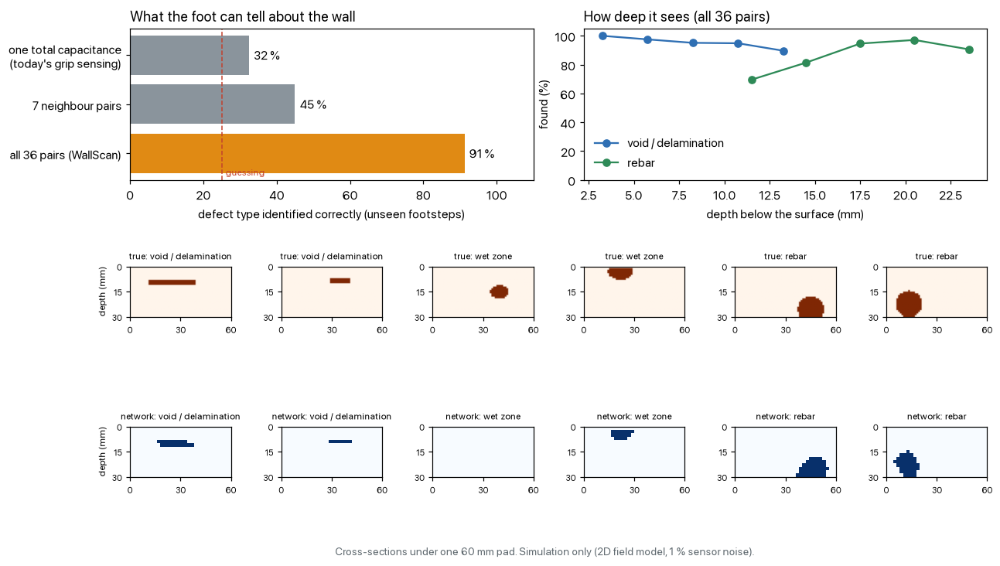
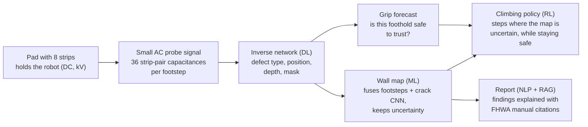

# WallScan: feet that see inside the wall

**The idea:** the electroadhesive pads that hold ElectroClimb on the wall are also a sensor. Split each pad's comb into 8 separately wired strips, measure the capacitance between every pair while the foot is stuck, and a neural network tells what is under the foot: a void (delamination), a wet zone or a rebar, where it is and how deep. Every footstep becomes a small scan of the first centimetres of the wall, with no extra sensor to carry.

<p align="center"></p>

**Status: a simulation study, not a working sensor.** The results below come from a 2D field model. Nothing has been measured on hardware yet.

## What exists, and what doesn't

| Field | What is already published | Source |
|---|---|---|
| Capacitive imaging of concrete | Coplanar electrodes scanned over concrete detect cracks, voids, moisture and rebar. Done with dedicated hand-held or scanned probes. | [Review of coplanar capacitive sensing, Sensors 2024](https://www.ncbi.nlm.nih.gov/pmc/articles/PMC11314776/); [rebar detection, Sensors 2022](https://www.ncbi.nlm.nih.gov/pmc/articles/PMC9323606/) |
| Electroadhesion self-sensing | The capacitance of an electroadhesive pad tells whether it is in contact or attached. It depends on the material, but works best for a previously known object. | [Adhesion state estimation, Actuators 2022](https://www.mdpi.com/2076-0825/11/10/283); [EA review, Advanced Intelligent Systems 2022](https://advanced.onlinelibrary.wiley.com/doi/full/10.1002/aisy.202200064) |
| Climbing robots that inspect below the surface | They carry separate instruments: ground-penetrating radar, impact-echo, ultrasonic tomography. The adhesion system and the sensor are different hardware. | [Wall-climbing robot with vision and impact sounding, Missouri S&T](https://scholarsmine.mst.edu/project_as-6/1/); [visual + GPR climbing robot, IEEE](https://ieeexplore.ieee.org/document/8397858/); [climbing robot + ultrasonic tomography, NDT-CE 2025](https://www.ndt.net/article/ndtce2025/papers/7131.pdf) |
| Deep learning for capacitance tomography | Networks reconstruct permittivity images from electrode-pair measurements, mostly for pipes and micro-scale sensor chips. | [Planar CMOS array + deep learning, 2023](https://arxiv.org/pdf/2309.09039v1) |
| Legs as sensors | "Every step is an experiment": legged robots probe terrain with their feet, and RL policies learn movements that improve their estimates. | [Active perception for legged locomotion, CMU](https://publications.ri.cmu.edu/active-perception-for-legged-locomotion-every-step-is-an-experiment); [Active Sensing Motor Policies, CoRL 2023](https://proceedings.mlr.press/v229/margolis23a/margolis23a.pdf) |

**The gap:** in these searches I found no work that uses the adhesion electrodes of a climbing robot to image the inside of the wall it is holding. A search for electroadhesion combined with capacitance tomography or dielectric spectroscopy returned nothing; the closest results use a pad's capacitance only for contact and proximity. This is a search result, not a proof of novelty: a patent and full literature review is still needed before claiming it.

## How it would work



- **Physics:** neighbouring strips couple through the first millimetres of the wall; strips far apart couple through deeper material. Air (εr = 1), dry concrete (εr 5–8), wet concrete (εr 15–30) and steel change those couplings in different patterns.
- **Deep learning:** a network inverts the 36 measurements into what is under the pad.
- **Reinforcement learning:** the climbing policy gets a reward for reducing the map's uncertainty, so it chooses footholds that are both safe and informative.
- **Machine learning:** footstep scans and the camera's crack detections are fused into one wall map with uncertainty.
- **NLP and RAG:** the inspector asks questions in plain language, and the report cites inspection-manual pages (already built in [`inspection/rag.py`](../inspection/rag.py)).
- **A second use:** the same measurement could forecast how well a foothold will grip before the robot commits to it, which is exactly what the three marginal test walls need.

## First test, in simulation ([`sensing/wallscan.py`](../sensing/wallscan.py))

A finite-difference solver computes the electric field through a cross-section of pad and concrete (1 mm grid) for 12,000 random footsteps: random concrete permittivity, a random contact layer, and one of four cases (sound, void, wet zone, rebar) with random size and depth. 1 % noise is added to every measurement. Networks are trained on 9,600 footsteps and tested on 2,400 unseen ones.

| Measurements used | Defect type correct | Position error | Depth error | Mask overlap (IoU) |
|---|---|---|---|---|
| One total capacitance (today's grip sensing) | 32 % | 11.2 mm | 4.3 mm | 0.00 |
| 7 neighbour pairs | 45 % | 9.3 mm | 3.9 mm | 0.15 |
| **All 36 pairs (WallScan)** | **91 %** | **2.4 mm** | **1.1 mm** | **0.56** |

Guessing gives 25 %. Per class with all 36 pairs: sound 94 %, void 95 %, wet zone 90 %, rebar 87 %.

| Depth | 3 mm | 6 mm | 8 mm | 11 mm | 13 mm |
|---|---|---|---|---|---|
| Voids found | 100 % | 98 % | 95 % | 95 % | 90 % |

Rebar is found in 70 % of cases at 12 mm and 91–97 % at 18–24 mm; shallow rebar is sometimes mistaken for a wet zone.

**What this shows:** the information is in the pair measurements, and one capacitance per pad is not enough. That is a design input for the foot: wire the strips separately.

```bash
uv pip install --python .venv scipy matplotlib
cd sensing
../.venv/bin/python wallscan.py data     # simulate 12,000 footsteps (~10 min on 8 cores)
../.venv/bin/python wallscan.py train    # train, evaluate, write media/wallscan.png
```

## What could kill it

- **Reading picofarads next to 3 kV.** The probe signal must be separated from the holding voltage and the HV driver's noise. This is the hardest engineering problem and is untested.
- **The contact layer dominates.** Micro air gaps under the pad change the near-surface readings strongly. The simulation varies the contact layer, but only coarsely (1 mm cells; the real insulator is 50 µm).
- **Real concrete conducts.** Moisture and salts add losses and frequency effects that this static model ignores. Multi-frequency measurement may turn that into extra information (chloride), or into confusion.
- **Depth.** A 60 mm pad can only see about as deep as its electrode spacing: one to two centimetres. Deep rebar and deep voids stay invisible; GPR and impact-echo remain the tools for those.
- **2D and idealised.** Real pads, edges, aggregates and 3D defects will lower every number above.

## Next steps

1. **Bench test:** an 8-strip pad on concrete samples with a known void, wet zone and steel bar, no high voltage. Everything is prepared: Gerber files, predicted readings, a results sheet and an analysis script ([`hardware/foot/BUILD.md`](../hardware/foot/BUILD.md), level 1). The far-pair signals are only hundredths of a picofarad, so the measurement itself is the first hurdle.
2. **Add the holding voltage** and measure how much the readings degrade.
3. **3D field model** fitted to the bench data; retrain the network on it.
4. **Active sensing in the RL environment:** add the scan to the simulated robot and reward uncertainty reduction.
5. **Literature and patent search** before any novelty claim in a paper.
