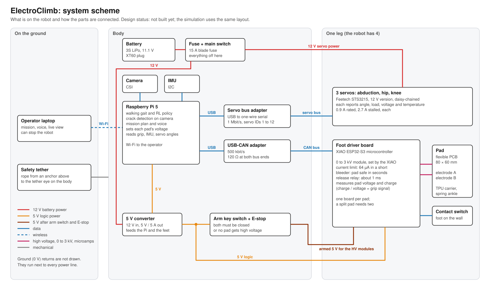
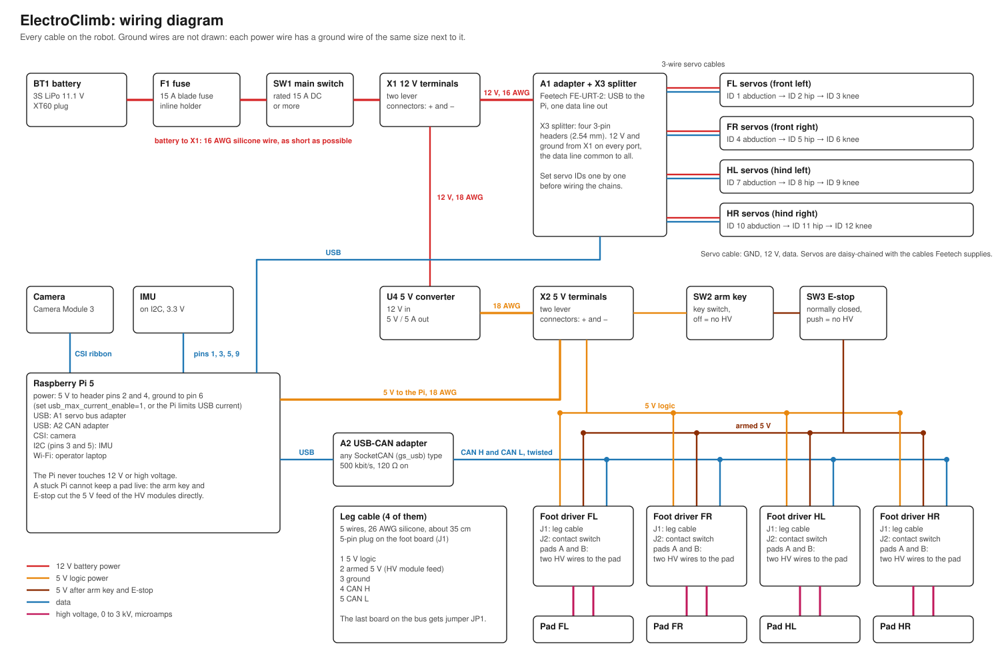

# Hardware

Everything needed to build ElectroClimb, as far as it is designed today.

> **Status: nothing here has been built.** The files are generated by scripts and checked by scripts and by KiCad. Each folder says plainly what was checked and what was not. The high-voltage parts (1–3 kV) must only be built and powered with a supervisor.

| What | Where | Checked how |
|---|---|---|
| **System scheme**: what is on the robot and how it connects | [`system/system_scheme.svg`](system/system_scheme.svg) | drawn by [`system/draw.py`](system/draw.py) |
| **Wiring diagram**: every cable, fuse, switch and connector | [`system/wiring_diagram.svg`](system/wiring_diagram.svg) | drawn by the same script |
| **Bill of materials**, cost and mass budget | [`BOM.md`](BOM.md) | part numbers read from datasheets where marked |
| **Foot**: pad, carrier, spring ankle, build guide | [`foot/`](foot/) | pad generator self-test, CAD checks |
| **Driver board**: schematic, KiCad PCB, Gerbers | [`foot/driver/`](foot/driver/) | KiCad rule check: 0 errors, 0 unconnected pads |
| **Body and legs**: chassis, brackets, thighs, shin links, cover | [`robot/cad/`](robot/cad/) | CAD checks: joint positions match the simulation, no collisions in the poses the gait uses |

## The main open points

1. **Pad force is unknown.** Every result in this repository assumes 15 N per pad. The hold test in the [foot build guide](foot/BUILD.md) is the first thing to measure.
2. **Weight.** The parts add up to about 1.57 kg; the simulation assumes 1.46 kg. See the [mass budget](BOM.md#mass-budget).
3. **Cost of high voltage.** Each driver needs a module of about €270.
4. **The release relay** on the driver board is used above its switching rating. See the [driver notes](foot/driver/README.md#open-points-before-ordering).
5. **The servo dimensions** in the body CAD come from a drawing and a third-party model, not from a servo on the desk. Measure one before printing a full set.
6. **Not designed yet:** a mount for the driver board on the leg, the foot contact switch mount, the IMU choice, and all firmware.

Licence: CERN-OHL-S v2, see [`LICENSE`](LICENSE).
