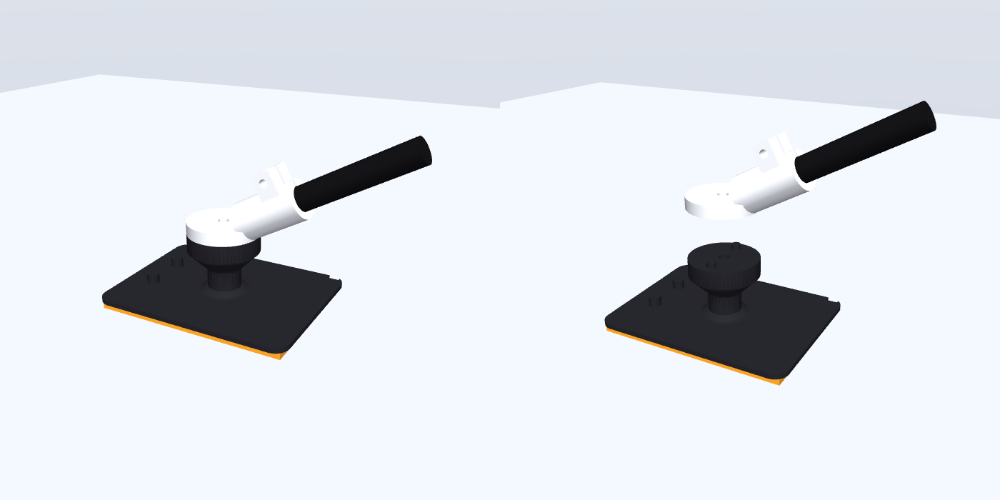

# Build one foot

A step-by-step guide to build and test **one ElectroClimb foot**. It is split into three levels so you can get real measurements early and cheaply, and only handle high voltage at the end.

> ⚠️ **High voltage in levels 2 and 3.** 1–3 kV at microamps can still give a painful shock and destroy electronics. Work with a supervisor, use the current-limiting resistor and bleeder described below, and discharge the pad before touching it. Level 1 uses no high voltage.

> **Status:** nobody has built this foot yet. The CAD is checked by script (valid solids, parts fit, printable walls) but not printed. Treat every number as a starting point and write down what you change.

| Level | What you learn | High voltage | Rough cost |
|---|---|---|---|
| **1. WallScan bench test** | Can pad electrodes sense a void, water or steel in concrete? | none | €30–60 |
| **2. Hold test** | How many newtons does a pad hold on glass, wood and concrete? | lab supply | €40–70 + a borrowed HV supply |
| **3. Foot with its own driver** | Switching, release time, grip sensing on the foot | on-board | + €230–270 for the HV module |

## Files

| File | What it is |
|---|---|
| [`cad/foot_carrier_tpu.step`](cad/foot_carrier_tpu.step) / `.stl` | Pad carrier with the flexure ankle, one piece, TPU 95A |
| [`cad/shin_adapter_petg.step`](cad/shin_adapter_petg.step) / `.stl` | Clamp for the 10 mm carbon shin tube, PETG or PA-CF |
| [`cad/foot_assembly.step`](cad/foot_assembly.step) | Both parts in place |
| [`cad/foot_cad.py`](cad/foot_cad.py) | The parametric source (CadQuery). Change `PARAMS`, re-run, the checks run again. |
| [`electroclimb.pretty/EA_Pad_80x60_F1_G1.kicad_mod`](electroclimb.pretty/) | Adhesion pad: two interdigitated combs, 1 mm fingers and gaps |
| [`electroclimb.pretty/WS_Pad_80x60_S8_G2.kicad_mod`](electroclimb.pretty/) | WallScan test pad: 8 separate strips, 7.75 mm wide, 2 mm apart |

## Parts

Prices are rough, from distributor listings in November 2026. Check them before ordering.

| # | Part | Qty | For level | About |
|---|---|---|---|---|
| 1 | Flex PCB, 1 layer, polyimide, 80 × 60 mm (adhesion pad and WallScan pad) | 5 of each | 1, 2 | €25–40 per design for 5 pieces, plus shipping. Covered by the AISLER or Seeed sponsorship if agreed. |
| 2 | TPU 95A filament, 25 g | – | all | €1 |
| 3 | PETG or PA-CF filament, 10 g | – | all | €0.50 |
| 4 | Carbon tube 10 mm outer / 8 mm inner, 100 mm | 1 | all | €3 |
| 5 | M4 × 12 socket-head screw + M4 hex nut | 1 | all | €0.30 |
| 6 | M3 × 16 screw + M3 nut (tube clamp) | 1 | all | €0.20 |
| 7 | Adhesive transfer tape, 50 µm (3M 468MP or similar), 80 × 60 mm | 1 | all | €2 |
| 8 | Silicone HV wire rated ≥ 5 kV, 0.5 m red + 0.5 m black | 1 | 2, 3 | €4 |
| 9 | HV resistor 47 MΩ, ≥ 5 kV (current limit) and 1 GΩ, ≥ 5 kV (bleeder) | 1 each | 2, 3 | €6 |
| 10 | Capacitance meter: LCR meter from the lab, or an FDC2214 chip on a breakout (chip about €5–7) | 1 | 1 | lab, or €10–20 |
| 11 | Luggage scale or 5 kg load cell + HX711 | 1 | 2 | €8 |
| 12 | Test surfaces: glass pane, plywood, a concrete paving slab | 1 each | 1, 2 | €10 |
| 13 | XP Power A30P-5 / AG30P-5, 0–3 kV HV module | 1 | 3 | **about $230–265** ([Mouser](https://www.mouser.com/ProductDetail/XP-Power/A30P-5?qs=w/v1CP2dgqqpsSpnz/QFMg%3D%3D), [Digi-Key](https://www.digikey.com/en/products/detail/xp-power/A30P-5/5873510)). The AG30P-5 may be discontinued; confirm before designing it in. |
| 14 | HV reed relay, XIAO ESP32-S3, small parts (see [`bom.csv`](bom.csv)) | 1 set | 3 | €25 |

**The HV module is the expensive part.** Four feet with split pads would need eight of them, which is over €2,000. Finding a cheaper high-voltage source is an open task; one shared supply with a relay per pad half is the first option to test.

## Print

| Part | Material | Settings |
|---|---|---|
| `foot_carrier_tpu` | TPU 95A | Plate flat on the bed. 0.2 mm layers, 3 walls, 100 % infill in the neck (use a modifier or print it all solid: 25 g), slow (25 mm/s), no supports: the cone under the flange is 45°. |
| `shin_adapter_petg` | PETG or PA-CF | Flange on the bed. 0.2 mm layers, 4 walls, 40 % infill, supports under the tube socket where it overhangs the flange. |

After printing, check: the M4 nut slides into the slot in the flange, the two nubs fit the adapter's sockets, and the carbon tube slides 22 mm into the socket.

The neck is the ankle spring. With TPU at E ≈ 26 MPa its bending stiffness is about 6 N·m/rad, the value used in simulation. Real TPU varies by about ±50 %, so measure it (step 6) and change `neck_d` if needed: stiffness grows with the fourth power of the diameter.

## Assemble

1. **Pad on the carrier.** Stick the transfer tape to the flat underside of the carrier plate and trim it. Lay the flex PCB on a clean glass plate with the electrode side down, and press the carrier onto its back, tabs towards the two notches. Roll it down firmly; no bubbles.
2. **Wires.** Solder the HV wires to the two tabs (level 1: thin hook-up wire to each of the 8 tabs). Keep the joints as flat as you can and cover them with polyimide tape. Route the wires up through the notches.
3. **Nut.** Slide the M4 nut into the slot in the flange.
4. **Adapter.** Seat the adapter on the two nubs and fasten it with the M4 × 12 screw from the top. Snug only; TPU compresses.
5. **Tube.** Push the carbon tube 22 mm into the socket and tighten the M3 clamp screw.
6. **Check the ankle.** Hold the tube and push the pad edge sideways with a scale: tilting the pad 10° (0.17 rad) at 40 mm from the centre should take about 25 N if the stiffness is 6 N·m/rad. Note the real value.

## Level 1: WallScan bench test (no high voltage)

Goal: find out whether the pair capacitances really change over a void, water and steel, as the simulation says.

1. Make three concrete samples about 20 mm thick, or use paving slabs: one plain, one with a 3 mm air gap behind a 5 mm layer (two tiles with spacers), one with a steel bar close under the surface. For moisture, wet a patch of the plain sample and let the surface dry.
2. Lay the 8-strip pad on the sample with a 1 kg weight on the carrier.
3. Measure the capacitance between strip pairs 1–2, 1–3, 1–5 and 1–8 with the LCR meter at 10 kHz and 100 kHz. Repeat on each sample, five times each, lifting and replacing the pad every time.
4. Write the results into a table.

**What counts as a result:** the simulation predicts changes of tens of percent on the far pairs (1–5, 1–8) over a shallow void. If the differences between samples are larger than the spread between your five repeats, the idea survives its first test. If the repeats scatter more than the samples differ, the contact layer dominates, and that is the answer.

Note: this test pad has 7.75 mm strips; the simulation used 5 mm strips on a 60 mm pad. Re-run [`sensing/wallscan.py`](../../sensing/wallscan.py) with the real geometry before comparing numbers.

## Level 2: hold test (lab high-voltage supply)

Goal: the single most important number in the project. How much shear force does one pad hold?

1. Wire the pad to the lab HV supply **through the 47 MΩ resistor**, with the 1 GΩ bleeder across the pad. Supply off.
2. Clamp the test surface vertically. Press the pad on it and hang the scale from the tube.
3. Supervisor present. Switch on, raise to 1 kV, wait 10 s, then pull down on the scale slowly until the pad slips. Note the force.
4. Repeat at 2 kV and 3 kV, on glass, wood and concrete, five times each. Switch off and wait for the bleeder (about 5 s) before touching the pad.

| Result per pad at 3 kV | Shear stress (48 cm² pad) | What it means |
|---|---|---|
| ≥ 15 N | ≥ 3.1 kPa | Matches the simulation. The robot design stands for this surface. |
| 5–15 N | 1–3 kPa | The robot must get lighter or the pads bigger for this surface. |
| < 5 N | < 1 kPa | This surface is out of reach for a 1.5 kg robot with these pads. |

Put the measured values into `adh_gain` in the simulation; that replaces the 15 N placeholder that every result so far rests on.

## Level 3: the foot's own driver

Build the driver from [`README.md`](README.md) section 3 and [`driver_schematic.svg`](driver_schematic.svg). Verify the module's pinout from its datasheet first. Then measure: time to full grip, release time with the reed relay, and whether the grip signal on the sense resistor tells contact from no contact.

## Open questions this build should answer

- Does the transfer tape hold flex PCB to TPU under shear, or is a different adhesive needed?
- Is one flexure neck stiff enough sideways and soft enough to let the pad lie flat?
- **Adhesion needs fine fingers (about 1 mm); WallScan worked with wide strips (5–8 mm).** One pad that does both needs a layout that has not been designed yet, for example fine combs grouped into 8 separately wired zones.
- Can a cheaper high-voltage source replace the €230+ module?
