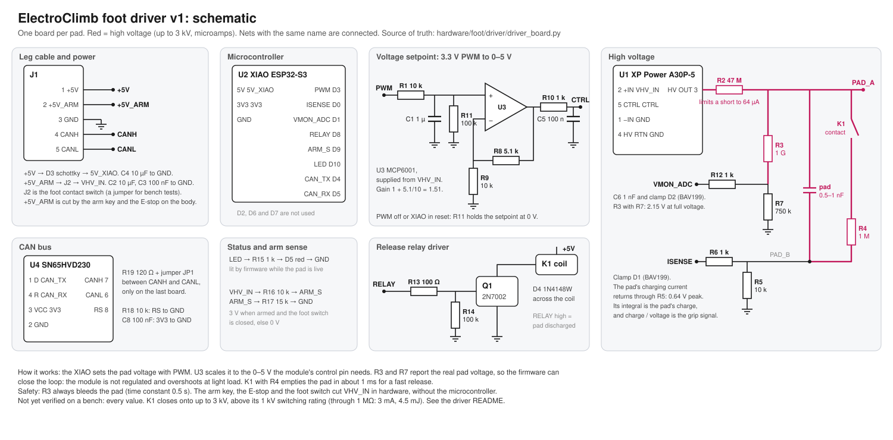

# Stage 1: electroadhesive foot

> ⚠️ **High voltage.** The foot runs at 1–3 kV. The current is limited to microamps, but a charged pad or capacitor can still give a painful shock and damage electronics. Build and test only with a supervisor, behind the interlock described below, and discharge everything before touching it.

Goal of stage 1: one foot that **holds reliably on concrete, glass and wood** and **measures its own grip**, plus a test rig that produces the data for the adhesion model used in simulation.

## 1. How big does a foot have to be?

| | Value | Note |
|---|---|---|
| Robot mass | 1.5 kg | target, see main README |
| Weight force | 14.7 N | |
| Feet in stance (crawl gait) | 3 | worst case in a trot: 2 |
| Shear per foot, crawl | 4.9 N | 7.4 N in a trot |
| Safety factor | 3 | adhesion varies a lot with dust and humidity |
| **Required shear per foot** | **~15 N** | ~22 N in a trot |

Electroadhesive shear stress in published work ranges from roughly 0.5 kPa on rough or dusty surfaces to a few kPa on smooth, clean glass. **This range is what the test rig has to measure for our pads.** Assuming 3 kPa, 15 N needs ~50 cm² per foot. That is why the first pad is **80 × 60 mm** (48 cm²) and the gait will start as a slow crawl.

## 2. Pad (flexible PCB)

```
 HV+ tab        HV− tab
   ┌┴──────────────┴┐
   │█━━━━━━━━━━━━━━ █│  ← interdigitated fingers on one copper layer
   │█ ━━━━━━━━━━━━━━█│     covered by polyimide coverlay (the dielectric)
   │█━━━━━━━━━━━━━━ █│
   │█ ━━━━━━━━━━━━━━█│
   └─────────────────┘
   bus A        bus B
```

| Parameter | First design | Why |
|---|---|---|
| Stack-up | 1-layer flex: 25 µm polyimide base, 18 µm copper, 25 µm polyimide coverlay | thin dielectric = stronger field at the surface |
| Electrode | interdigitated (coplanar), two nets | works on conductive and non-conductive surfaces |
| Finger width / gap | 1.0 mm / 1.0 mm | to be swept on the rig (0.5–2 mm) |
| Edge margin | 2.0 mm | keeps HV away from the pad edge |
| Backing | 3D-printed TPU or foam, 2–3 mm | lets the pad conform to rough surfaces |
| Extra coating | optional thin silicone or Plasti-Dip | raises breakdown margin, adds friction |

The layout is generated by [`tools/gen_electrode.py`](../../tools/gen_electrode.py), so finger width, gap and size can be swept without hand-drawing.

## 3. High-voltage driver (one per foot)



| Ref | Part | Value | Why |
|---|---|---|---|
| U1 | XP Power **AG30P-5** (fallback Q30-5) | 0–3 kV, 1 W, 5 V in | proportional, with a separate control pin a microcontroller can drive |
| R1, C1 | setpoint filter | 10 kΩ, 10 µF | XIAO PWM → 0–5 V control voltage |
| R2 | fault limit | 47 MΩ | short current 64 µA, 0.19 W worst case |
| R3 | safety bleeder | 1 GΩ | always connected; drains the pad in seconds if anything fails |
| K1 + R4 | HV reed relay + dump resistor | 1 MΩ | **fast release**, τ ≈ 1 ms |
| R5 | sense resistor | 10 kΩ | return current → ADC, 0.64 V peak, low-voltage side |
| R6, D1 | ADC protection | 1 kΩ + clamp | protects the XIAO if the pad flashes over |
| S1 | interlock | foot contact + arm switch | no HV unless both are closed |

All values come from [`tools/driver_calc.py`](../../tools/driver_calc.py), which checks the design rules: pad voltage loss ≤ 5 %, fault current ≤ 100 µA, R2 ≤ 0.25 W in a short, charge time ≤ 150 ms, release ≤ 10 ms, and a sense signal inside the ADC range. Change a value and re-run it.

- **Voltage control:** the XIAO sets the voltage, which gives the RL policy a continuous **adhesion action** (0–100 %).
- **Why the relay is required:** a bleeder small enough to release the foot quickly would also steal the pad voltage through R2. So the bleeder is large (safety only), and K1 does the fast release.
- **Still to verify before layout:** U1 pinout and output-current curve from the official datasheet, and voltage/power ratings of R2–R4 and K1.

## 4. Grip sensing (capacitance)

Contact changes the pad capacitance: with nothing in front of it, the field goes into the air, and against a surface, it goes into the material. Two ways to measure it, both designed so the sensing electronics stay on the **low-voltage side**:

1. **Charge measurement (v1):** when the pad is energised, the return current flows through R5 at ground potential. The XIAO samples it at 20 kHz (about 470 samples per charge time constant) and integrates it digitally to get the charge Q, so C = Q / V. That's measured at every step with no extra hardware. The known R3 bleed current is subtracted.
2. **AC sensing (v2):** a capacitance-to-digital converter measures the pad through isolation while the HV is off, in short windows between steps. More sensitive, used to compare against v1.

The **grip estimate** fed to the policy is the capacitance change relative to free air, ΔC/C₀. Stage 1 checks how well ΔC predicts the measured holding force.

## 5. Test rig

| Part | Purpose |
|---|---|
| Load cell + HX711 amplifier | shear and normal holding force (reuses the IVC cage weighing code) |
| Linear stage | pulls the pad at a set speed and peel angle |
| Temperature / humidity sensor | adhesion depends strongly on humidity |
| Test surfaces | glass, smooth concrete, rough concrete, plywood, painted wall, + dusted versions |
| Logger script | records voltage, ΔC, force, humidity → CSV for the adhesion model |

Each run sweeps **voltage × surface × humidity × peel angle**. The result is the data-driven adhesion model that goes into simulation in stage 2.

## 6. Safety checklist

- [ ] Supervisor and lab approval before the first power-up
- [ ] HV only enabled while a hardware interlock (foot contact switch + arm switch) is closed
- [ ] Bleeder resistor on every pad. Never assume a pad is discharged.
- [ ] HV probe rated above 3 kV for measurements. Never a normal multimeter.
- [ ] Creepage ≥ 3 mm on every PCB carrying HV, with no traces under the module
- [ ] Insulated enclosure for the driver. One hand rule when working near it.

## 7. Stage 1 milestones

1. Generate pad layouts (3 finger/gap variants) → order flex PCBs
2. Driver board v1 schematic + layout (module-based)
3. Test rig built, logger running
4. Sweep: voltage × surface × humidity → first adhesion dataset
5. Pick the best pad, and show that ΔC predicts holding force

**Done when:** a pad holds ≥ 15 N shear on glass and smooth concrete, and ΔC distinguishes "holding" from "slipping".
