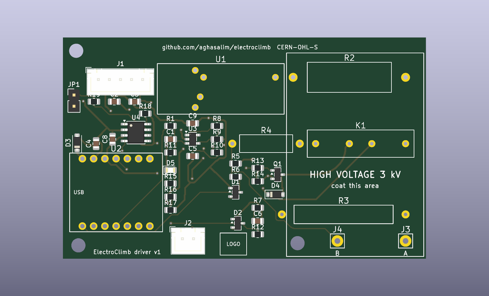
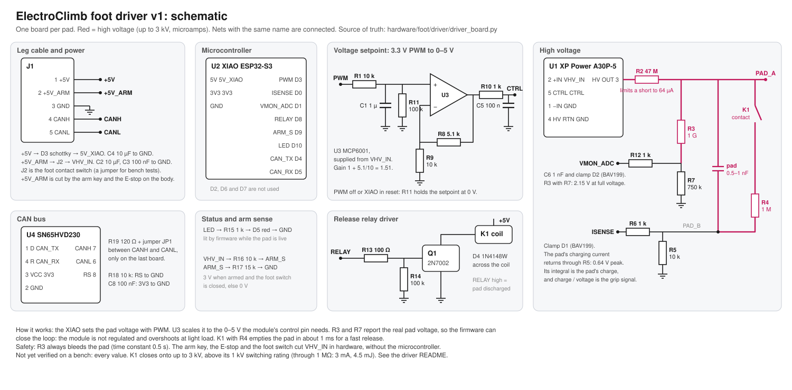

# Foot driver board v1

> ⚠️ **High voltage.** This board makes up to 3 kV. The current is limited to microamps, but it can still give a painful shock and destroy electronics. Build and power it only with a supervisor.

> **Status: designed and rule-checked by script, never manufactured, never powered.** KiCad's design-rule check reports 0 errors and 0 unconnected pads. That proves the copper matches the netlist and keeps its distances. It does not prove the circuit works. Read [Open points](#open-points-before-ordering) before ordering.

One board drives one electroadhesive pad: it sets the pad voltage (0–3 kV), limits the current, releases the pad in about a millisecond, and measures pad voltage and charge so the robot knows how well the foot grips.

<p align="center"></p>

Schematic: [`../driver_schematic.svg`](../driver_schematic.svg)



## Files

| File | What it is |
|---|---|
| [`driver_board.py`](driver_board.py) | **The source.** Parts, pin-to-net table, placement, the hand-routed high-voltage tracks and a small router for the rest. Change it and run `build.sh`. |
| [`electroclimb_driver.kicad_pcb`](electroclimb_driver.kicad_pcb) | The board, opens in KiCad 10. 82 × 50 mm, 2 layers. |
| [`electroclimb_driver.kicad_dru`](electroclimb_driver.kicad_dru) | The high-voltage spacing rule KiCad checks: 5.5 mm from any high-voltage copper to anything else. |
| [`fab/electroclimb_driver.zip`](fab/electroclimb_driver.zip) | Gerber and drill files, plus the placement file for assembly. |
| [`bom.csv`](bom.csv) | Parts list for one board, with the part to order. |
| [`netlist.md`](netlist.md) | Every net and the pins on it. |
| [`drc.rpt`](drc.rpt) | KiCad's check report for the committed board. |
| [`build.sh`](build.sh) | Regenerates everything above and fails if KiCad finds an error. |

```bash
./build.sh
```

## How it works

| Block | Parts | What it does |
|---|---|---|
| High-voltage module | U1 XP Power A30P-5 | 5 V in, 0–3 kV out, 1 W. Its control pin sets the output from 0 to 100 %. |
| Voltage setpoint | R1, C1, R11, U3, R8–R10, C5 | The XIAO's PWM (3.3 V) is filtered and multiplied by 1.51, because the control pin needs 0–5 V. With no PWM, R11 holds the setpoint at 0 V. |
| Current limit | R2 47 MΩ | A shorted pad draws 64 µA at most. |
| Bleeder and voltage monitor | R3 1 GΩ, R7 750 kΩ, R12, C6, D2 | Always connected: empties the pad in seconds if everything else fails. The same divider reports the real pad voltage (2.15 V at full voltage), so firmware can regulate it. The module itself is not regulated and overshoots at light load. |
| Fast release | K1, R4 1 MΩ, Q1, D4, R13, R14 | The reed relay shorts the pad through 1 MΩ: empty in about 1 ms. |
| Grip sensing | R5 10 kΩ, R6, D1 | The pad's charging current returns through R5 at ground level. Its integral is the charge; charge divided by voltage is the capacitance, which rises when the pad touches a surface. |
| Interlock | J2, R16, R17 | The module's 5 V feed arrives on its own wire, already switched by the arm key and the E-stop on the body, and passes through the foot contact switch on J2. No software is involved. The XIAO only reads whether it is armed. |
| CAN | U4, R18, R19, JP1 | 500 kbit/s to the Raspberry Pi. Fit the JP1 jumper on the last board of the bus. |

XIAO pins: D3 PWM, D0 pad current, D1 pad voltage, D8 release relay, D9 armed, D10 LED, D4 CAN TX, D5 CAN RX. Firmware is not written yet.

Values are checked by [`tools/driver_calc.py`](../../../tools/driver_calc.py). Run it after changing any resistor.

## Layout choices

- **High voltage on the right, logic on the left.** The three high-voltage nets (`HV_OUT`, `PAD_A`, `DUMP`) are routed by hand on the bottom layer.
- **5.5 mm spacing** from high-voltage copper to everything else. The relay sets this number: its coil pins are 7.62 mm from its contact pins. General-purpose spacing tables ask for more at 3 kV (roughly 8 mm with coating), so **coat the high-voltage area** with conformal coating or silicone after soldering and testing.
- **No top-side tracks under the module or under the high-voltage resistors.** XP Power asks for this under the module; the resistor bodies sit at up to 3 kV.
- **Nylon M3 screws and spacers** in the three mounting holes.
- The XIAO goes on two 1 × 7 pin sockets with its USB-C plug towards the board edge (marked `USB`).
- Footprints for U1, K1, R2, R3 and R4 were drawn from the manufacturers' drawings (XP Power A series p. 6, Standex-Meder SHV p. 3, Vishay VR25/VR37/VR68, Ohmite Mini-Mox).

## Open points before ordering

1. **Relay switching rating.** K1 (Standex-Meder SHV05-1A85, 4 kV version) may stand off 4 kV but is rated to *switch* 1 kV. Here it closes onto up to 3 kV, through 1 MΩ: 3 mA peak and 4.5 mJ. That is a small load, but it is outside the datasheet. Either test it on the bench for contact life, or fit a relay rated to switch the full voltage. The ones found are much larger: Cynergy3 DAT70510 (60 mm long, 23 g) or Standex-Meder HE12-1A83 (12 V coil). No small 5 V relay rated to switch above 3 kV was found.
2. **Relay coil polarity.** The SHV order code has an option letter (`D` or `L`) whose meaning the series datasheet does not explain. If `D` is an internal diode, the coil has a polarity: check the product datasheet. The board puts +5 V on pin 2.
3. **BAV199 pin numbers.** The clamp diodes D1 and D2 assume pin 1 = anode, pin 2 = cathode, pin 3 = common. The datasheet read for this design did not print pin numbers.
4. **Print the board 1:1 on paper** and lay U1, K1 and the high-voltage resistors on it before ordering. No footprint has been test-fitted.
5. **Sponsor logo.** The silkscreen has an empty box marked `LOGO`. AISLER's sponsorship asks for their logo on the silkscreen from the first order: place their artwork there in KiCad before uploading.
6. **One board per pad.** The simulation's best results use pads split into two halves. That needs two of these boards per foot, or a two-channel version of this board.
7. **Cost.** The A30P-5 costs about €270 (DigiKey, November 2026). No module under €100 with these ratings was found.
8. **Spacing review.** Ask the lab supervisor to review the high-voltage spacing and the coating before the first power-up.

## Ordering

Upload `electroclimb_driver.kicad_pcb` (AISLER takes KiCad files directly) or `fab/electroclimb_driver.zip`. 2 layers, 1.6 mm FR4, any solder mask colour. A stencil helps for the 0805 parts.
