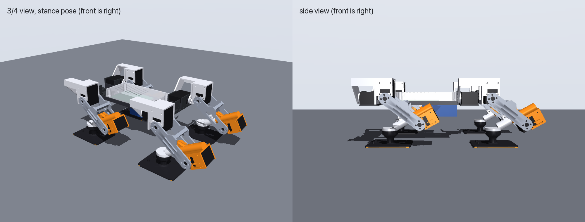

# Robot body and legs: printed parts

Parametric CAD (CadQuery) for the ElectroClimb chassis and the four legs, built around 12 Feetech STS3215 servos and the existing foot in [`../../foot/cad`](../../foot/cad).

<p align="center"></p>

> **Status: nobody has printed these parts.** The script checks geometry (valid solids, joint positions, collisions, bed size). It does not check strength, stiffness, tolerances or that a real servo matches the model. Measure one servo before printing a full set.

```bash
cd hardware/robot/cad
../../../.venv/bin/python robot_cad.py    # checks, then STEP + STL for every part, and the tables below
../../../.venv/bin/python preview.py      # preview.png
```

## Parts

All parts: PETG or PA-CF, 0.2 mm layers, 4 walls, 40 % infill. Nearly every wall is 2.4 to 3 mm, so the parts print solid; masses below are solid PETG (1.27 g/cm³). The STEP and STL files are already turned into the print orientation.

| File | Qty | g each | Print orientation |
|---|---|---|---|
| `chassis` | 1 | 82 | Plate on the bed, walls up. No support. 237 × 140 mm: fits a 256 mm bed in one piece. |
| `top_cover` | 1 | 29 | Roof on the bed. No support. 1.2 mm walls, not structural. |
| `abd_bracket_left` / `_right` | 2 + 2 | 23 | Roof on the bed, all plates standing. No support. |
| `thigh_left` / `_right` | 2 + 2 | 20 | On the straight edges of the two plates. The crossbar is a 36 mm bridge; the 3 mm spacer bosses and cable ribs are short overhangs. No support. |
| `shin_link_left` / `_right` | 2 + 2 | 15 | Standing on the servo-tail end, tube tunnel vertical. No support. |
| `robot_assembly.step` | – | – | Everything in the stance pose, with servo dummies and the four feet. |

Printed parts 345 g, fasteners about 68 g, 12 servos 660 g: **frame + servos 1073 g**. With Pi 5, camera, battery, buck module, tubes, feet and wiring (estimates, about 430 g) the robot comes to about **1.5 kg before any high-voltage supply**. The 1.5 kg target has no margin left; with the HV modules it will be missed unless the frame or the battery gets lighter.

Also needed: 4 pieces of 10 mm carbon tube, **74.7 mm long** (52.7 mm in the shin link, 22 mm in the foot adapter). The script computes this from the foot's socket geometry.

## How a leg is built

- **Abduction servo** lies in the chassis, output along +x, 20 mm behind the hip axis. All four face forward, so the hind servos sit behind the hind hips.
- **`abd_bracket`** sits on that servo's horn and idler and holds the **hip servo** body, pointing up.
- **`thigh`** is a plain link: two plates on the horn and idler of the hip servo and of the knee servo, 80.6 mm between the axes.
- **`shin_link`** holds the **knee servo** body (tail pointing away from the foot) and clamps the carbon tube, which runs along the side of the servo into the foot adapter.

Servo bodies are held by thin plates on their two faces, fastened with the M2 self-tapping screws into the case, as on the SO-ARM100.

## Fasteners

| Qty | Fastener | Where |
|---|---|---|
| 96 | M2 × 6 self-tapping pan head (PA2.0) | Servo cases to holder plates, 8 per servo |
| 48 | M3 × 6 button head + M3 washer | Horn-side plates into the 12 output horns, 4 each. The washer keeps the screw from touching the servo case. |
| 24 | M3 × 8 button head | Idler-side plates into the 12 idler horns, 2 each (4 holes are there) |
| 4 | M3 × 16 socket head + M3 nut | Shin tube clamps |
| 4 | M3 × 8 + M3 heat-set insert | Top cover |
| 4 | M2.5 × 6 + M2.5 heat-set insert | Raspberry Pi 5 |
| 4 | M2 × 8 + M2 nut | Camera |

## Assembly order

1. Press the heat-set inserts into the chassis (4 × M3 cover bosses, 4 × M2.5 Pi standoffs).
2. Take the horn off every servo. Set every servo to its middle position first.
3. Chassis: drop the 4 abduction servos between their walls, 8 M2 screws each, then put the horns back on.
4. Bracket: slide a hip servo up into the bracket from below, 8 M2 screws, horn back on. Slide the bracket over the abduction servo's horn and idler and bolt it.
5. Shin link: slide the knee servo in from the open end, 8 M2 screws, horn back on. Push the carbon tube in to the stop and tighten the M3 clamp.
6. Thigh: slide it over the hip servo's and the knee servo's horns and bolt both ends.
7. Foot: push the foot adapter 22 mm onto the tube, pad parallel to the chassis in the stance pose, tighten its clamp.
8. Servo cables: chassis → abduction → hip → knee, on the inner (idler) side of the leg. Red high-voltage pair: in the rib channels on the outer side of the thigh and shin link, 35 mm or more from the servo cables there. At the hip and at the foot the two runs come closer; keep 10 mm by hand.
9. Battery under the plate with two straps, buck module and Pi on top, camera on the front plate, cover last.

## Checked by the script

- Every part is one valid solid and fits a 250 mm bed.
- Joint positions measured on the parts' holes: abduction axes at y = ±60, z = 0; hip axes at x = ±100; hip plane 20 mm outboard; thigh 80.62 mm; knee to ankle 67.08 mm (through the tube and the real foot adapter STEP).
- Stance pose and zero pose: 38 solids (parts, servo dummies, tubes, feet), no pair intersects by more than 1 mm³. Nothing below the pad plane in stance; 49 mm under the battery.
- Joint ranges, one front and one hind leg, other joints in stance, 10° steps:

| Joint | Free range found | Simulation range | What stops it |
|---|---|---|---|
| Abduction | −30° … +30° | −30° … +30° | – |
| Hip | −90° … +40° | −90° … +90° | Foot adapter hits the chassis at +50° |
| Knee | 0° … 80° | 0° … 150° | Foot adapter hits the thigh crossbar at 90° |

**The climbing gait fits.** Every leg pose the crawl gait uses on a vertical wall in simulation (hip −61° … −23°, knee 57° … 80°, 64 poses of a front and a hind leg) was tested against these parts, each also with 3° more knee bend: no collision. The gait runs right up to the knee limit, so there is no room for a longer stride without changing the thigh crossbar.

Sample poses (hip, knee): (−60, 20) free, (0, 80) free, (−60, 140), (+60, 20) and (+60, 140) collide. **The simulation's knee range above about 80° and hip range above about +40° cannot be reached by this hardware**; the simulation should be limited to match. The stance knee angle is 57°, so only about 23° of extra knee flexion is left.

## NOT verified

- **Servo dimensions.** Body size, axis position and weight are from the Feetech drawing. Horn and idler face heights, the M2 hole positions, the horn screw circle and the cable socket position are measured in the SO-ARM100 STEP model, not on a servo. Every such number is marked `# NOT VERIFIED` in `PARAMS`.
- **Idler horn threads**, and whether all 8 M2 case holes are free for mounting.
- **Cable plugs.** The model leaves a window and 2.6 mm over the rear face. If the plugs stand higher, they foul the idler-side plates.
- **12 V servo version**: weight and torque are taken from the 7.4 V specification and seller listings.
- **Strength and stiffness.** No load calculation. Weakest spots, in order: the M2 self-tapping screws in the servo cases (all leg loads go through them), the 2.4 mm holder plates, the bracket's long strip to the abduction idler.
- **Servo torque.** The simulation allows 3 N·m per joint, which is the stall torque of the 12 V servo, not what it can hold continuously. The crawl gait peaks at 0.9 N·m on a vertical wall in simulation. That is about the servo's rated torque (10 kg·cm, 0.98 N·m, at 0.9 A), so the hip and knee servos would work near their rating while the robot hangs on the wall: measure their temperature early.
- **Fits.** 0.3 mm gaps between sliding plates; screw heads, horn splines and cables are not modelled.
- **Mass of everything that is not printed** except the servos.

## Different from the simulation and the first plan

- The hind abduction servos face forward like the front ones (not outward). Facing outward they would sit in the path of the hind thigh in the stance pose. The chassis therefore reaches from x = −157 to +80 mm, not ±100.
- The knee servo sits in the shin link, not in the thigh. In the thigh it would intersect the existing foot adapter in the stance pose, because the adapter's tube runs 17.9 mm beside the knee–ankle line and its socket ends 19 mm from the knee.
- The chassis is 72 mm wide in the middle (140 mm at the servos), not 120, so the legs can abduct inwards.
