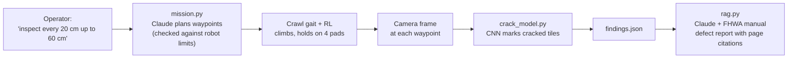
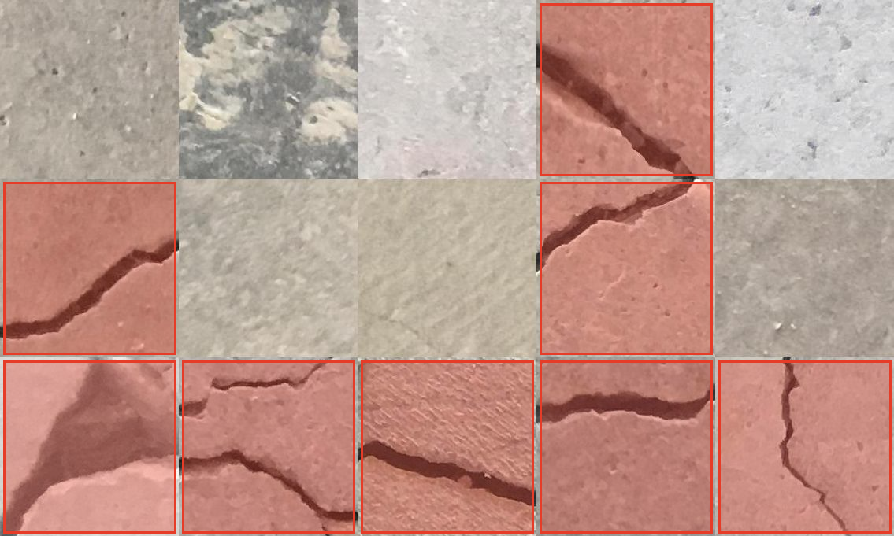
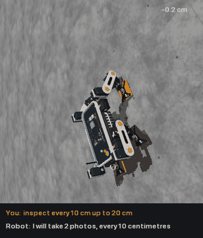

# Inspection (stage 5): crack vision, RAG assistant, mission planner

The climbing robot exists to inspect walls. This folder holds the AI that turns a climb into an inspection.



```bash
uv pip install --python ../.venv -r requirements.txt
cd inspection
```

## Crack detection ([`crack_model.py`](crack_model.py))

A small CNN (4 conv blocks, 61k parameters, 255 KB) that says whether a 227 px concrete tile shows a crack.

```bash
../.venv/bin/python crack_model.py train           # ~10 min on an Apple GPU (MPS)
../.venv/bin/python crack_model.py scan wall.jpg   # -> wall_cracks.png
```

| | Result |
|---|---|
| Training data | 32,000 photos (80 %), fixed split |
| Validation | 99.6 % after 4 epochs |
| **Held-out test** | **99.25 % on 4,000 photos never seen in training** |
| Wall scan of 15 unseen tiles | 15 / 15 correct |

<p align="center"></p>
<p align="center"><em>The scan cuts a wall photo into tiles and marks the cracked ones. All 15 tiles are from the held-out test set.</em></p>

Data: *Concrete Crack Images for Classification*, Ç. F. Özgenel, Mendeley Data v2, [doi:10.17632/5y9wdsg2zt.2](https://doi.org/10.17632/5y9wdsg2zt.2), CC BY 4.0. Download it yourself and unpack it to `data/cracks/{Positive,Negative}/`; it is not in this repository. The scan image above shows tiles from that dataset.

**Limits:** the dataset is close-up photos from one campus, so the model still has to be checked on the robot's own camera, lighting and distance. It classifies tiles; it does not measure crack width.

## RAG inspection assistant ([`rag.py`](rag.py))

Retrieval-augmented generation over the **FHWA Bridge Inspector's Reference Manual** (2023, FHWA-NHI-23-024, US government work) and this project's docs.

1. **Index:** every page of the 1,300-page manual is split into 1,500-character passages (2,066 passages).
2. **Retrieve:** BM25 ranking finds the 8 passages that best match the question (no extra packages).
3. **Generate:** the passages go to Claude Opus 5.5 as `search_result` blocks with citations on. Claude answers only from them, and every claim carries the page it came from.

```bash
../.venv/bin/python rag.py index
../.venv/bin/python rag.py search crack width measurement      # retrieval only, free
../.venv/bin/python rag.py ask "How should crack width be measured and recorded?"
../.venv/bin/python rag.py report findings.json                 # defect report for one climb
```

Download the manual from [fhwa.dot.gov](https://www.fhwa.dot.gov/bridge/nbis/pubs/nhi23024.pdf) to `data/docs/fhwa_birm_2023.pdf`. Asking questions needs an Anthropic API key; each question is one request.

## LLM mission planner ([`mission.py`](mission.py))

Claude turns an operator's sentence into a mission plan (structured output: waypoints with height, `inspect` or `pass`, hold time). The plan is checked against the robot's limits (0–100 cm on the test wall, climbs only up, hold ≤ 10 s); a plan that breaks them goes back to Claude with the reasons. The crawl gait then climbs to each waypoint in MuJoCo, finishes its step so all four pads are stuck, holds and saves a camera frame.

```bash
../.venv/bin/python mission.py "inspect the wall every 20 cm up to 60 cm"
../.venv/bin/python mission.py --plan plan.json        # run a saved plan without an API call
```

Tested with a saved plan (inspect at 10 cm, pass 15 cm, inspect at 20 cm): reached 13.6, 18.1 and 22.7 cm (the gait finishes its 4 cm cycle first), and slipped 0.03 cm during each 2 s hold. A plan to 150 cm is rejected.

## Talking to the robot ([`voice.py`](voice.py))

The robot climbs in MuJoCo in real time and listens the whole time, so an order, a question or "stop" works in the middle of a climb. It answers out loud.

<p align="center"></p>

```bash
../.venv/bin/python voice.py                 # live; add --speed 4 to run faster than real time
../.venv/bin/python voice.py --selftest
```

| You say | The robot does |
|---|---|
| "climb to 40 cm", "climb another 20 cm" | climbs there and shortens its last step to stop on the target |
| "come down", "come down to 10 cm" | climbs down (new: the gait runs backwards) |
| "inspect every 10 cm up to 50 cm" | stops at each height on four pads, takes a photo, says "crack found" or "no crack" |
| "photo" | takes a photo where it is |
| "stop", "resume" | freezes at once with every pad on; carries on |
| "status", "check your grip", "why did you stop?" | height, what it is doing, how hard each pad presses on the wall |
| "report" | says a summary and writes `missions/voice-…/report.md` with findings and the transcript |

A recorded run:

```
You: inspect every 10 cm up to 20 cm
Robot: I will take 2 photos, every 10 centimetres up to 20.
You: stop
Robot: Stopped at 4 centimetres. All pads are on.
You: why did you stop
Robot: You told me to stop.
You: resume
Robot: No crack at 10 centimetres. I am 100 percent sure.
Robot: Crack found at 19 centimetres. I am 100 percent sure.
You: check your grip
Robot: front-left 13, front-right 13, hind-left 16, hind-right 17 newtons. All four pads hold.
You: come down
Robot: Done. I am at -1 centimetres with all four pads on.
You: report
Robot: I took 2 photos and found cracks at 19 centimetres.
```

**How it works, and its limits**

- **Speech out** is the macOS `say` command. **Speech in** is typed text, or the microphone with `voice.py --mic`: Whisper base.en runs on the Mac, offline after one 145 MB download (`pip install faster-whisper sounddevice`). `voice.py --mictest` checks the recogniser without a microphone: five spoken orders must come back as the right orders.
- **Talk in the room is ignored.** From the microphone, only short sentences that are orders get through, plus anything that says "robot" ("Robot, what does the manual say about wide cracks?"). Everything else is printed as ignored and the robot stays quiet. Typed text is never filtered.
- **"Stop" works while the robot is talking.** The robot knows the sound it is playing, so it subtracts its own voice from the microphone and listens to what is left. Only "stop", "pause", "freeze" and "quit" are accepted this way, and they cut it off mid-sentence; other orders wait until it is quiet. In the self-test, with a simulated room echo, "stop" spoken over the robot is heard 6 times out of 6. On real laptop speakers the subtraction is weaker and not yet measured properly, so **a bare Return in the terminal always stops the robot**, and headphones make the spoken stop reliable. In a noisy room raise the threshold with `--mic-level 0.03`.
- **Understanding** is a small set of rules for the orders in the table, so it works offline. Other sentences go to Claude (the mission planner for orders, the manual assistant for questions) when a valid API key is set. That path has not been tested live.
- **The camera is a stand-in.** The simulated wall has no cracks, so each 10 cm band of the wall is given one photo from the held-out part of the crack dataset, and the real CNN classifies it. It shows the pipeline, not the camera.
- **Climbing down** slips about 1 cm over 20 cm. Targets are reached within about 1 cm.
- Simulation only. On the real robot this would run on a laptop or phone that talks to the robot.
