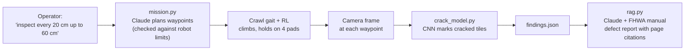

# Inspection (stage 5): crack vision, RAG assistant, mission planner

The climbing robot exists to inspect walls. This folder holds the AI that turns a climb into an inspection.



```bash
uv pip install --python ../.venv -r requirements.txt
cd inspection
```

## Crack detection ([`crack_model.py`](crack_model.py))

A small CNN (4 conv blocks, 61k parameters, 255 KB) that says whether a 227 px concrete tile shows a crack.

```bash
../.venv/bin/python crack_model.py train           # ~10 min on an Apple GPU (MPS)
../.venv/bin/python crack_model.py scan wall.jpg   # -> wall_cracks.png
```

| | Result |
|---|---|
| Training data | 32,000 photos (80 %), fixed split |
| Validation | 99.6 % after 4 epochs |
| **Held-out test** | **99.25 % on 4,000 photos never seen in training** |
| Wall scan of 15 unseen tiles | 15 / 15 correct |

<p align="center"></p>
<p align="center"><em>The scan cuts a wall photo into tiles and marks the cracked ones. All 15 tiles are from the held-out test set.</em></p>

Data: *Concrete Crack Images for Classification*, Ç. F. Özgenel, Mendeley Data v2, [doi:10.17632/5y9wdsg2zt.2](https://doi.org/10.17632/5y9wdsg2zt.2), CC BY 4.0. Download it yourself and unpack it to `data/cracks/{Positive,Negative}/`; it is not in this repository. The scan image above shows tiles from that dataset.

**Limits:** the dataset is close-up photos from one campus, so the model still has to be checked on the robot's own camera, lighting and distance. It classifies tiles; it does not measure crack width.

## RAG inspection assistant ([`rag.py`](rag.py))

Retrieval-augmented generation over the **FHWA Bridge Inspector's Reference Manual** (2023, FHWA-NHI-23-024, US government work) and this project's docs.

1. **Index:** every page of the 1,300-page manual is split into 1,500-character passages (2,066 passages).
2. **Retrieve:** BM25 ranking finds the 8 passages that best match the question (no extra packages).
3. **Generate:** the passages go to Claude Opus 5.5 as `search_result` blocks with citations on. Claude answers only from them, and every claim carries the page it came from.

```bash
../.venv/bin/python rag.py index
../.venv/bin/python rag.py search crack width measurement      # retrieval only, free
../.venv/bin/python rag.py ask "How should crack width be measured and recorded?"
../.venv/bin/python rag.py report findings.json                 # defect report for one climb
```

Download the manual from [fhwa.dot.gov](https://www.fhwa.dot.gov/bridge/nbis/pubs/nhi23024.pdf) to `data/docs/fhwa_birm_2023.pdf`. Asking questions needs an Anthropic API key; each question is one request.

## LLM mission planner ([`mission.py`](mission.py))

Claude turns an operator's sentence into a mission plan (structured output: waypoints with height, `inspect` or `pass`, hold time). The plan is checked against the robot's limits (0–100 cm on the test wall, climbs only up, hold ≤ 10 s); a plan that breaks them goes back to Claude with the reasons. The crawl gait then climbs to each waypoint in MuJoCo, finishes its step so all four pads are stuck, holds and saves a camera frame.

```bash
../.venv/bin/python mission.py "inspect the wall every 20 cm up to 60 cm"
../.venv/bin/python mission.py --plan plan.json        # run a saved plan without an API call
```

Tested with a saved plan (inspect at 10 cm, pass 15 cm, inspect at 20 cm): reached 13.6, 18.1 and 22.7 cm (the gait finishes its 4 cm cycle first), and slipped 0.03 cm during each 2 s hold. A plan to 150 cm is rejected.
