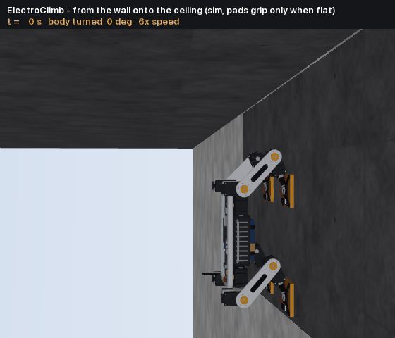
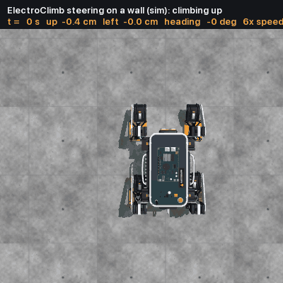
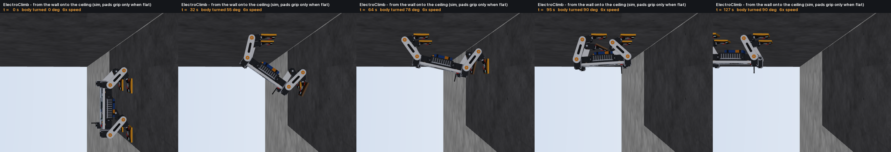
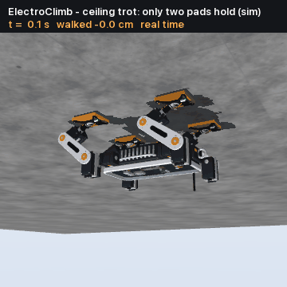

# Simulation (stage 2)

MuJoCo model, climbing environment and a baseline crawl gait for ElectroClimb.

<p align="center"></p>

```bash
uv venv --python 3.12 .venv && uv pip install --python .venv -r sim/requirements.txt
cd sim
../.venv/bin/python check_physics.py    # holds on the wall with pads on, slides off without
../.venv/bin/python crawl_gait.py       # baseline gait climbs floor, 45 deg and vertical wall
../.venv/bin/python make_assets.py      # regenerate meshes, textures and electroclimb.xml (only after design changes)
../.venv/bin/python render_media.py     # GIFs + hero image -> ../media/
../.venv/bin/python render_pillar.py    # climbing a 40 cm concrete pillar -> ../media/climb_pillar.gif
```

## How climbing is simulated

The robot always stands on one plane. **Gravity is rotated** instead of building walls:

| tilt | surface |
|---|---|
| 0° | floor |
| 90° | vertical wall (climbing up = +x) |
| 135° | overhang |
| 180° | ceiling |

This gives the training curriculum directly: start on the floor and raise the tilt as the policy improves.

## Model ([`electroclimb.xml`](electroclimb.xml))

- 1.46 kg quadruped with 12 servo joints (hip abduction, hip flexion, knee per leg). Servos are modelled on SO-101-class STS3215: kp 25, 3 Nm limit.
- Crouched stance (body ~9 cm off the wall) to keep the **peel moment** small
- 2 passive, spring-loaded ankle joints per foot. The pads are pre-rotated so the spring holds them **flat** in the stance.
- **Electroadhesion = MuJoCo `adhesion` actuator** per foot: action 0–1 is pad voltage 0–100 %, gain 15 N max pull
- IMU: orientation, gyro, accelerometer
- **Looks and physics are separate:** hidden `col` shapes carry all mass and contacts. The detailed `vis` meshes (servos, links, feet, brain PCB, enclosure) are generated by [`make_assets.py`](make_assets.py) with [`meshkit.py`](meshkit.py) into `assets/`, and have no mass and no contacts. Mass (1.46 kg), inertia, the 18.0 cm climb and the 88 % hard-wall score are identical before and after. In the renders, pads and their LEDs are bright while energised and dull while released.

## Environment ([`env.py`](env.py))

- **Action (16):** 12 joint offsets around the standing pose plus 4 pad voltages
- **Observation:** joint positions and velocities, IMU, per-foot grip estimate (noisy capacitance proxy), previous action
- **Reward:** progress up the wall, minus effort and pad energy, minus 10 for falling
- **Randomisation per episode:** surface factor (0.4–1.0), humidity factor (0.7–1.0), and a small per-step chance that a pad loses grip

The adhesion model is a **placeholder**. It gets replaced by the data-driven model from the stage 1 test rig (voltage × surface × humidity × peel angle).

## Baseline crawl gait ([`crawl_gait.py`](crawl_gait.py))

The gait plans feet in the body frame and converts them to joint angles with inverse kinematics, solved on a copy of the MuJoCo model. One leg at a time:

**release pad → lift → move up 4 cm → come down until the grip sensor reports contact → re-stick**

Then the body pulls itself up on all four pads.

One safety rule made the difference on the wall: **never lift a foot until every other foot reports contact.** Until then, the gait waits and presses the missing foot down.

| Surface | Climbed in 20 s | Fell |
|---|---|---|
| Floor (0°) | 20.5 cm | no |
| Slope (45°) | 19.0 cm | no |
| **Vertical wall (90°)** | **18.0 cm** | **no** |

This is the baseline the reinforcement-learning policy has to beat. It also shows the real design problems the hardware must solve:

| Problem found in simulation | Fix | What it means for the real robot |
|---|---|---|
| Tall body: gravity peels the upper feet off the wall | Crouched stance, body 16 → 9 cm | Keep the centre of mass low |
| Passive ankle spring held pads tilted, so only the edges stuck | Pads pre-rotated to sit flat in the stance | Foot geometry must keep the pad flat |
| Swung foot landed short, then the next foot released | Reach until contact + wait for all other feet | Capacitance contact sensing is essential, not optional |
| Weak surface (40 % grip) cannot hold a vertical wall | n/a, this is physics | Bigger pads or a lighter robot; the policy must avoid weak patches |

## Reinforcement learning ([`rl_env.py`](rl_env.py), [`train.py`](train.py))

**Residual RL:** PPO (Stable-Baselines3) learns corrections on top of the crawl gait (12 joint offsets plus gait speed) instead of learning to climb from scratch. Training walls are randomised: tilt, grip 55–100 %, humidity, and sudden pad drop-outs.

```bash
../.venv/bin/python train.py --steps 2500000                 # ~20 min on 8 CPU cores
../.venv/bin/python train.py --eval runs/best/best_model.zip  # vs baseline on 30 random walls
../.venv/bin/python render_rl.py runs/best/best_model.zip     # side-by-side GIF
```

**Results so far (30 random vertical walls, 20 s each):**

| | Climbed | Falls |
|---|---|---|
| Baseline crawl gait | 9.2 cm | 13 % |
| RL run 1 (pad voltage in action, tilt 45–90°, fall −20) | −9.6 cm | 40 % |
| RL run 2 (no pad action, tilt 75–90°, fall −100) | 0.6 cm | 30 % |

**RL has not beaten the baseline yet.** What was checked:
- The pipeline is correct: an untrained policy outputs actions under 0.02 and scores exactly like the baseline.
- Run 1 failed because exploration could lower pad voltage (instant falls), and a −20 fall penalty made rushing on easier 45° walls worthwhile.
- Run 2 hovers at baseline level and drifts worse. The likely cause is physics, not tuning: on the weakest training walls (55 % grip), three stuck pads give 3 × 15 N × 0.55 × 0.6 ≈ 14.9 N against a 14.3 N weight. That's no margin. A crawl gait must lift a foot, so joint corrections can't save those walls.

### Runs 3–6: hold action, target ≥ 90 % success

Success = no fall and ≥ 10 cm up in 20 s. Test set: 40 hard vertical walls (grip 55–100 %, humidity 80–100 %, random pad drop-outs). Physical ceiling ≈ 95 %: on 2 of the 40 walls three pads cannot hold the robot's weight. [`auto_train.sh`](auto_train.sh) runs the sweep.

| | lr | log-std | steps | Success | Falls | Climbed |
|---|---|---|---|---|---|---|
| Baseline crawl gait | | | | 80 % | 15 % | 8.6 cm |
| Run 3 | 1e-4 | −2.0 | 3M | 82 % | 15 % | 8.3 cm |
| **Run 4** | 3e-5 | −2.5 | 3M | **82 %** | **12 %** | **10.0 cm** |
| Run 5 | 1e-4 | −1.5 | 4M | 78 % | 20 % | 5.5 cm |
| Run 6 | 5e-5 | −2.0 | 5M | 82 % | 12 % | 9.1 cm |

All runs score 100 % on holdable walls (grip ≥ 70 %), the same as the baseline.

**The 90 % target was not reached.** The best policy gains 2 points over the baseline. In every run, training performance drops after about 1M steps, so the best checkpoints are early ones that stay close to the baseline. With joint residuals, gait speed and hold, PPO finds no strategy that saves the marginal walls.

### Runs 7–10: foot choice, press force, body height

The action now also has body height (±1.5 cm toward the wall), stance-foot press (up to 1 cm), and a per-leg preference that picks which foot steps next (19 actions; the observation adds the swinging leg). A zero action is still exactly the baseline gait.

| | lr | log-std | steps | Success | Falls | Climbed |
|---|---|---|---|---|---|---|
| Baseline crawl gait | | | | 80 % | 15 % | 8.6 cm |
| Run 7 | 3e-5 | −2.5 | 3M | 80 % | 18 % | 7.9 cm |
| Run 8 | 1e-4 | −2.0 | 3M | 82 % | 12 % | 9.1 cm |
| Run 9 | 1e-4 | −1.5 | 4M | 82 % | 12 % | 8.8 cm |
| Run 10 | 5e-5 | −2.0 | 5M | 82 % | 12 % | 9.8 cm |

**Still 82 %.** Why the 8 failing baseline walls are hard to save:

| Test walls | Grip | Cause |
|---|---|---|
| 0, 4 | 0.50–0.53 | Fall on the first step: three pads can't hold 14.3 N. Unholdable. |
| 15, 17, 30 | 0.54–0.56 | Fall when the first upper foot lifts (peel moment). Only 2–6 % margin. |
| 5, 10, 34 | ~0.6 | Random pad drop-outs. Without them they climb 13–16 cm. |

A sweep of fixed lever values made things worse, not better: body lower +1 cm 80 %, −1 cm 48 %; press 0.5 cm 65 %, 1 cm 25 %; gait speed 0.7 72 %. The realistic ceiling on this test set is about 36–38 of 40 (90–95 %), so the gap left is small and lives in the marginal walls.

### Pad drop-outs: split pads (hardware fix)

A drop-out lasts one control step (20 ms) and the voltage comes straight back, so the robot has already slid before any reaction can land. Three gait-side recovery triggers were tried (a stance foot losing contact, the body sliding down, the driver seeing a pad's voltage collapse), each followed by holding still and re-pressing the feet. None beat the plain gait: stance feet briefly lose contact about 50 times per episode in normal walking, and every hold costs climbing time.

The fix is in hardware: **split each pad into two halves with their own driver**, so a drop-out only loses half a pad (`drop_level=0.5` in [`env.py`](env.py), now the default).

| Plain crawl gait, 40 hard walls ([`eval_gait.py`](eval_gait.py)) | Success | Falls | Climbed |
|---|---|---|---|
| One-piece pads | 80 % | 15 % | 8.6 cm |
| **Split pads** | **88 %** | **12 %** | **10.9 cm** |
| Split pads, +5 % pad force | 90 % | 10 % | 12.4 cm |
| Split pads, +10 % pad force | 95 % | 2 % | 15.0 cm |
| Split pads, +20 % pad force | 100 % | 0 % | 17.5 cm |

Walls 5, 10 and 34 now pass. With split pads, constant body height, press force and stride changes don't save the remaining walls (15, 17, 30); RL runs 11 (lr 5e-5, log-std −2.0, 4M steps, on a second Mac) and 12 (lr 3e-5, log-std −2.5, 3M steps) both end at 88 %, equal to the gait.

**The 90 % target is a hardware margin question.** 10 % more pad force (for example 80 × 66 mm pads instead of 80 × 60 mm, or a robot about 10 % lighter) gives 95 % with the hand-written gait alone. Pad force in the simulation is still the 15 N placeholder, so the test rig has to confirm the real margin.

**Next:** measure real pad force on the test rig, then size the pads for at least 10 % margin on the worst surface the robot should climb. RL is still useful for walls the gait can't handle, with a curriculum and GPU-parallel simulation (MuJoCo MJX / Isaac Lab).

### More RL methods: SAC, curriculum, teacher-student

All on the 40 hard test walls with split pads, trained on the second Mac (M5 Max) over Tailscale.

```bash
../.venv/bin/python train.py --algo sac --out runs_sac            # off-policy SAC instead of PPO
../.venv/bin/python train.py --curriculum --out runs_curr         # walls from 75 % grip down to 55 %
../.venv/bin/python train.py --privileged --out runs_teacher      # teacher also sees true grip + drop-outs
../.venv/bin/python distill.py runs_teacher/best/best_model.zip   # DAgger: sensor-only student
```

| | Steps | Success | Falls | Climbed |
|---|---|---|---|---|
| Crawl gait, split pads | | 88 % | 12 % | 10.9 cm |
| PPO (runs 11, 12) | 3–4M | 88 % | 12 % | 11.1 cm |
| PPO + curriculum | 3M | 88 % | 12 % | **11.5 cm** |
| PPO teacher (privileged observations) | 3M | 88 % | 12 % | 11.2 cm |
| Student distilled from the teacher (DAgger, 5 rounds, 147k labelled states) | | 88 % | 12 % | 11.2 cm |
| SAC | 1M | 2 % | 32 % | −10.4 cm |

- **SAC fails here.** With a fall penalty and a survival bonus, freezing on the wall pays better than climbing, and off-policy SAC finds that shortcut within 20k steps. Two fixes were needed just to make it start like the gait (no random warm-up, zero-initialised action layer), and it still drifts away. PPO with a small learning rate stays close to the gait and keeps improving it slightly.
- **Curriculum** gives the best climb (11.5 cm) but no extra walls.
- **Teacher-student works:** the student copies the teacher exactly (imitation loss < 0.0001) using only sensors the robot has. But the teacher itself gained nothing from knowing the true grip, which confirms that walls 15, 17 and 30 are a force-margin problem, not a perception problem.

## Flat pads, steering, the corner and the ceiling trot

Added on 25 November 2026. Files: [`steer.py`](steer.py), [`flat.py`](flat.py), [`eval_flat.py`](eval_flat.py), [`corner.py`](corner.py), [`tune_trot.py`](tune_trot.py), [`render_corner.py`](render_corner.py).

<p align="center"></p>

### A weakness in the original simulation

MuJoCo's adhesion pulls with full force as soon as any part of a pad touches. Measured on the original crawl gait: **the pads stand on an edge, tilted about 30° to the wall, for most of every step**, and still grip. The gait lands each foot 4 cm ahead of the point where its pad is parallel to the body, and the 6 N·m/rad ankle is far too stiff to let the pad lie down. A real electroadhesive pad needs area contact, so every earlier result on this page is too kind.

[`flat.py`](flat.py) takes the gift away. Grip is scaled by flatness (full below 3° of tilt, none above 8°), and the gait only counts a pad as placed when it touches and lies flat. The gait itself is unchanged.

| Ankle stiffness, flat-only pads, same crawl gait | Wall | Ceiling |
|---|---|---|
| 6 N·m/rad (the original foot), 2, 1, 0.5, 0.3 | falls | falls |
| 0.25, 0.2 | climbs | falls |
| **0.15, 0.12, 0.1 (used), 0.03** | **climbs** | **climbs** |

**The fix is the ankle alone:** a soft pivot of 0.1 N·m/rad with ±45° of travel. The pad touches with an edge and lies down under a push of well under 1 N. One modelling detail mattered: the model gave the passive ankle the rotor inertia of a servo, which made the free pad swing for seconds; `flat.py` gives it the inertia of a pad. (An earlier version of this section said the feet also had to land at a different point. That was an effect of the swinging pad and is not needed.) The foot CAD now has this ankle: a 4.5 mm TPU neck, 0.1 N·m/rad by beam theory, not yet printed or measured (see [`hardware/foot/BUILD.md`](../hardware/foot/BUILD.md)).

### The 40 hard walls again ([`eval_flat.py`](eval_flat.py))

Same walls, same gait, same success rule as the tables above (no fall and at least 10 cm in 20 s); only the grip rule and the ankle differ.

| Crawl gait, split pads | Success | Falls | Climbed |
|---|---|---|---|
| Original simulation (pads grip on an edge) | 88 % | 12 % | 10.9 cm |
| **Flat-only pads** | **42 %** | **18 %** | 2.3 cm |
| Flat-only, +10 % pad force | 60 % | 5 % | 7.8 cm |
| Flat-only, +20 % pad force | 80 % | 0 % | 10.1 cm |
| Flat-only, +30 % pad force | 88 % | 0 % | 10.4 cm |
| **Flat-only, gait clock 12 % faster** | **82 %** | **15 %** | 6.5 cm |
| Flat-only, clock 12 % faster, +10 % pad force | 92 % | 5 % | 11.4 cm |
| Flat-only, clock 12 % faster, +20 % pad force | 98 % | 0 % | 14.0 cm |
| PPO + curriculum, retrained on flat-only pads (3M steps) | 42 % | 15 % | 3.5 cm |

- **Unchanged, the gait drops from 88 % to 42 %.** Most of that is slowness, not falls: waiting for each pad to lie flat slows the gait, and the walls without a fall climb 9.3 cm on average, just under the 10 cm line.
- **A 12 % faster gait clock brings it back to 82 %,** with slightly fewer falls. Faster still does not help much (25 %: 80 %, 60 %: 85 %). Standing 7 mm lower makes it much worse (25 %, 40 % falls); 7 mm higher gives 50 %.
- **The falls are a grip question, as before:** they are all on walls with grip below 70 %, and 10 % more pad force with the faster clock gives 92 %.
- **Retrained RL does not beat the gait.** PPO with the curriculum, the best earlier recipe, trained for 3M steps under the flat rule (`ELECTROCLIMB_FLAT=1 train.py --curriculum`): 42 % on the hard walls, the same as the unchanged gait, with 15 % falls instead of 18 %; on the easier "holdable" walls 92 % against 85 %. The policy may speed the clock up by 25 % but did not learn to. Small random joint corrections alone cost the gait its successes here, so exploration is harder than in the original simulation. The teacher-student and SAC runs were not repeated.

### Steering ([`steer.py`](steer.py), [`flat.py`](flat.py))

Each foot lands at its home point turned by `yaw` and moved by `(dx, dy)`; the body shift then moves and turns the body. Sideways motion uses the hip abduction joints. Five gait cycles each, flat-only pads, full grip:

| Command | Wall | Ceiling |
|---|---|---|
| Forwards | 18.6 cm in 27 s | 20.9 cm in 27 s |
| Backwards (down the wall) | 22.9 cm | 20.4 cm |
| Sideways | 10.3 cm, slides 2.1 cm down | 10.3 cm |
| Turn on the spot | 28°, slides 3.6 cm down | 28° |

<p align="center"></p>

It can walk in any direction and turn on both surfaces. On the wall it slides down a little during sideways steps and turns, and walking down it moves further than commanded.

### Wall to ceiling ([`corner.py`](corner.py))

<p align="center"></p>

The body follows a "ladder" path: it climbs until the front hips are about 11 cm under the ceiling, the front legs reach up and land flat on the ceiling, then the body turns 90° while the hind feet walk up the wall and the front feet walk out along the ceiling, and last the hind feet change over. A foot may only land where its pad is flat, and from a given hip there are at most two such places per surface, so the plan is a short search.

| | Result |
|---|---|
| Full run in MuJoCo, full grip, simulation joint limits | reaches the ceiling in 85 s (14 leg-pair steps), then walks on under the ceiling |
| Same with the printed parts' limits (hip −90…+60°, knee 0…80°) | reaches the ceiling in 112 s (20 leg-pair steps) |
| Peak joint torque | 1.2 N·m (the STS3215 is rated about 1 N·m) |
| Grip at 90 % or less | **falls** at 22° of the turn, when one front pad holds alone |
| Hip limited to +40° (the CAD before 25 November) | **no plan**: the hind legs get stuck at 62° |
| Sensitivity | the outward pull must be about 2 mm; of 1, 2, 3 and 4 mm only 2 mm works with the printed limits (1 to 3 mm with the simulation limits) |

So the corner works in simulation, with no grip margin and little tolerance in its settings. The hip CAD was changed to give the +60° it needs ([`hardware/robot/cad`](../hardware/robot/cad/README.md)), and the commanded joint speed is limited to 250°/s, about what the servo can do. Three things it needs that the plain gait does not:

- **Reach up from lower.** From the normal standing height the hip would need more than 90° to put a pad flat on the ceiling.
- **Pull outwards with the front legs.** The weight hangs further from the wall than the front pads are, so they would have to pull with more than the weight. A 2 mm outward command presses the hind pads on the wall and unloads the ceiling pads.
- **Correct every landing.** The body is never exactly on its planned path, so each landing point slides along the surface until the pad is parallel, and each landed foot pulls back to its planned point so the sag does not add up.

### Two pads on the ceiling ([`flat.py`](flat.py) `TrotGait`, [`tune_trot.py`](tune_trot.py))

Two diagonal legs step together, so only two pads hold. Two pads on soft ankles are a hinge: the body swings freely about the line between them. Under a ceiling it hangs like a pendulum and is level only while its centre of mass is under that line, so the standing pair pulls the body forward and sideways at the same time (`sway`). Without the sway it falls within 3 s.

<p align="center"></p>

The six trot numbers (stride, sway, two balance-feedback gains on the body's lean, swing height, clock speed) were found by policy search, the cross-entropy method: 12 generations of 32 walks, scored by distance over 20 s at 100, 90 and 80 % grip.

| Ceiling trot, flat-only pads | Result |
|---|---|
| Speed at full grip | 59 cm in 20 s (about 3 cm/s), against 0.9 cm/s for the crawl |
| Grip 85 % or more | 8 of 8 walks without a fall (parameters varied by 2 %) |
| Grip 80 % | 2 of 8 |
| Without sway and feedback | falls |
| Turning and sideways | work at full grip; sideways drives the servos to their 3 N·m limit |
| Backwards | falls |

Two pads must carry 14.3 N, so 48 % grip is the hard floor; the trot needs 85 %. It is fast but has much less margin than the crawl, which keeps three pads on.

On a wall this gait cannot work with soft ankles: gravity always turns the body about the hinge line, and nothing resists it.

```bash
../.venv/bin/python steer.py           # steering on the original physics
../.venv/bin/python flat.py            # crawl and trot with flat-only pads
../.venv/bin/python eval_flat.py       # the 40 hard walls with flat-only pads
../.venv/bin/python corner.py          # plan and run the corner
../.venv/bin/python tune_trot.py       # search the trot parameters (about 10 minutes)
../.venv/bin/python render_corner.py   # media/corner.gif
```

## Physics checks ([`check_physics.py`](check_physics.py))

| Case | Result |
|---|---|
| Vertical wall, pads on | holds (0.1 cm creep) ✅ |
| Vertical wall, pads off | slides off ✅ |
| Floor, pads off | stands ✅ |

## Next

1. Split pads with about 10 % more pad force than the current design (see above)
2. Replace the placeholder adhesion with the test-rig model
3. Floor-to-wall transitions

## Balance on three legs

`balance.py` works out how much grip each stance needs, with a force model and with MuJoCo: 41 % on four pads, 55–58 % with one leg lifted (upper leg worst). Explained in [`docs/HOW_IT_WORKS.md`](../docs/HOW_IT_WORKS.md#gravity-and-balance-standing-on-three-legs).

```bash
../.venv/bin/python balance.py figure
```

**Body lean, tested and rejected.** `LEAN` in `crawl_gait.py` leans the body sideways on the abduction joints while a leg swings (default 0 = off). On the 40 hard walls, split pads:

| Lean | Success | Falls |
|---|---|---|
| none | 88 % | 12 % |
| 0.1 rad away from the swing leg | 82 % | 12 % |
| 0.2 rad away | 57 % | 28 % |
| 0.1 rad towards | 78 % | 18 % |
| 0.2 rad towards | 60 % | 12 % |

On a vertical wall a sideways shift does not change the pad pressures, so there is little to gain, and tilting the pads on their ankles costs grip.

```bash
../.venv/bin/python eval_gait.py '{}' '{"LEAN": 0.1}' '{"LEAN": -0.1}'
```
