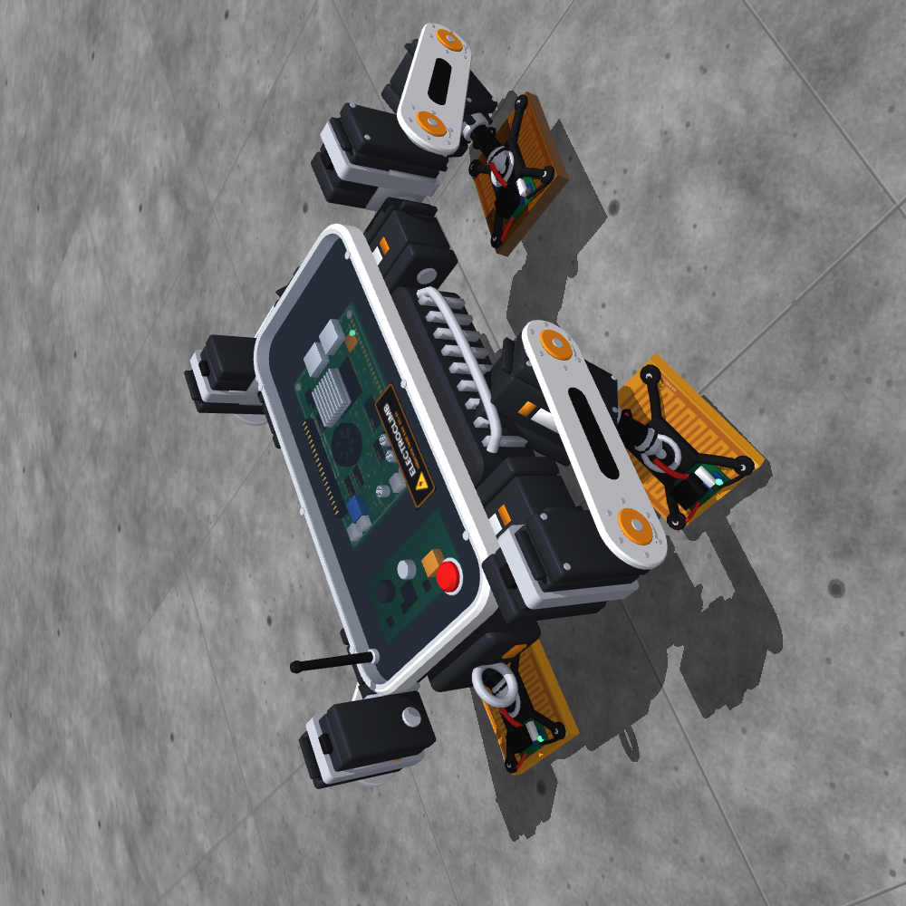

# Simulation (stage 2)

MuJoCo model, climbing environment and a baseline crawl gait for ElectroClimb.

<p align="center"></p>

```bash
uv venv --python 3.12 .venv && uv pip install --python .venv -r sim/requirements.txt
cd sim
../.venv/bin/python check_physics.py    # holds on the wall with pads on, slides off without
../.venv/bin/python crawl_gait.py       # baseline gait climbs floor, 45 deg and vertical wall
../.venv/bin/python render_media.py     # GIFs + hero image -> ../media/
../.venv/bin/python render_pillar.py    # climbing a 40 cm concrete pillar -> ../media/climb_pillar.gif
```

## How climbing is simulated

The robot always stands on one plane. **Gravity is rotated** instead of building walls:

| tilt | surface |
|---|---|
| 0° | floor |
| 90° | vertical wall (climbing up = +x) |
| 135° | overhang |
| 180° | ceiling |

This gives the training curriculum directly: start on the floor and raise the tilt as the policy improves.

## Model ([`electroclimb.xml`](electroclimb.xml))

- 1.46 kg quadruped with 12 servo joints (hip abduction, hip flexion, knee per leg). Servos are modelled on SO-101-class STS3215: kp 25, 3 Nm limit.
- Crouched stance (body ~9 cm off the wall) to keep the **peel moment** small
- 2 passive, spring-loaded ankle joints per foot. The pads are pre-rotated so the spring holds them **flat** in the stance.
- **Electroadhesion = MuJoCo `adhesion` actuator** per foot: action 0–1 is pad voltage 0–100 %, gain 15 N max pull
- IMU: orientation, gyro, accelerometer

## Environment ([`env.py`](env.py))

- **Action (16):** 12 joint offsets around the standing pose plus 4 pad voltages
- **Observation:** joint positions and velocities, IMU, per-foot grip estimate (noisy capacitance proxy), previous action
- **Reward:** progress up the wall, minus effort and pad energy, minus 10 for falling
- **Randomisation per episode:** surface factor (0.4–1.0), humidity factor (0.7–1.0), and a small per-step chance that a pad loses grip

The adhesion model is a **placeholder**. It gets replaced by the data-driven model from the stage 1 test rig (voltage × surface × humidity × peel angle).

## Baseline crawl gait ([`crawl_gait.py`](crawl_gait.py))

The gait plans feet in the body frame and converts them to joint angles with inverse kinematics, solved on a copy of the MuJoCo model. One leg at a time:

**release pad → lift → move up 4 cm → come down until the grip sensor reports contact → re-stick**

Then the body pulls itself up on all four pads.

One safety rule made the difference on the wall: **never lift a foot until every other foot reports contact.** Until then, the gait waits and presses the missing foot down.

| Surface | Climbed in 20 s | Fell |
|---|---|---|
| Floor (0°) | 20.5 cm | no |
| Slope (45°) | 19.0 cm | no |
| **Vertical wall (90°)** | **18.0 cm** | **no** |

This is the baseline the reinforcement-learning policy has to beat. It also shows the real design problems the hardware must solve:

| Problem found in simulation | Fix | What it means for the real robot |
|---|---|---|
| Tall body: gravity peels the upper feet off the wall | Crouched stance, body 16 → 9 cm | Keep the centre of mass low |
| Passive ankle spring held pads tilted, so only the edges stuck | Pads pre-rotated to sit flat in the stance | Foot geometry must keep the pad flat |
| Swung foot landed short, then the next foot released | Reach until contact + wait for all other feet | Capacitance contact sensing is essential, not optional |
| Weak surface (40 % grip) cannot hold a vertical wall | n/a, this is physics | Bigger pads or a lighter robot; the policy must avoid weak patches |

## Reinforcement learning ([`rl_env.py`](rl_env.py), [`train.py`](train.py))

**Residual RL:** PPO (Stable-Baselines3) learns corrections on top of the crawl gait (12 joint offsets plus gait speed) instead of learning to climb from scratch. Training walls are randomised: tilt, grip 55–100 %, humidity, and sudden pad drop-outs.

```bash
../.venv/bin/python train.py --steps 2500000                 # ~20 min on 8 CPU cores
../.venv/bin/python train.py --eval runs/best/best_model.zip  # vs baseline on 30 random walls
../.venv/bin/python render_rl.py runs/best/best_model.zip     # side-by-side GIF
```

**Results so far (30 random vertical walls, 20 s each):**

| | Climbed | Falls |
|---|---|---|
| Baseline crawl gait | 9.2 cm | 13 % |
| RL run 1 (pad voltage in action, tilt 45–90°, fall −20) | −9.6 cm | 40 % |
| RL run 2 (no pad action, tilt 75–90°, fall −100) | 0.6 cm | 30 % |

**RL has not beaten the baseline yet.** What was checked:
- The pipeline is correct: an untrained policy outputs actions under 0.02 and scores exactly like the baseline.
- Run 1 failed because exploration could lower pad voltage (instant falls), and a −20 fall penalty made rushing on easier 45° walls worthwhile.
- Run 2 hovers at baseline level and drifts worse. The likely cause is physics, not tuning: on the weakest training walls (55 % grip), three stuck pads give 3 × 15 N × 0.55 × 0.6 ≈ 14.9 N against a 14.3 N weight. That's no margin. A crawl gait must lift a foot, so joint corrections can't save those walls.

### Runs 3–6: hold action, target ≥ 90 % success

Success = no fall and ≥ 10 cm up in 20 s. Test set: 40 hard vertical walls (grip 55–100 %, humidity 80–100 %, random pad drop-outs). Physical ceiling ≈ 95 %: on 2 of the 40 walls three pads cannot hold the robot's weight. [`auto_train.sh`](auto_train.sh) runs the sweep.

| | lr | log-std | steps | Success | Falls | Climbed |
|---|---|---|---|---|---|---|
| Baseline crawl gait | | | | 80 % | 15 % | 8.6 cm |
| Run 3 | 1e-4 | −2.0 | 3M | 82 % | 15 % | 8.3 cm |
| **Run 4** | 3e-5 | −2.5 | 3M | **82 %** | **12 %** | **10.0 cm** |
| Run 5 | 1e-4 | −1.5 | 4M | 78 % | 20 % | 5.5 cm |
| Run 6 | 5e-5 | −2.0 | 5M | 82 % | 12 % | 9.1 cm |

All runs score 100 % on holdable walls (grip ≥ 70 %), the same as the baseline.

**The 90 % target was not reached.** The best policy gains 2 points over the baseline. In every run, training performance drops after about 1M steps, so the best checkpoints are early ones that stay close to the baseline. With joint residuals, gait speed and hold, PPO finds no strategy that saves the marginal walls.

### Runs 7–10: foot choice, press force, body height

The action now also has body height (±1.5 cm toward the wall), stance-foot press (up to 1 cm), and a per-leg preference that picks which foot steps next (19 actions; the observation adds the swinging leg). A zero action is still exactly the baseline gait.

| | lr | log-std | steps | Success | Falls | Climbed |
|---|---|---|---|---|---|---|
| Baseline crawl gait | | | | 80 % | 15 % | 8.6 cm |
| Run 7 | 3e-5 | −2.5 | 3M | 80 % | 18 % | 7.9 cm |
| Run 8 | 1e-4 | −2.0 | 3M | 82 % | 12 % | 9.1 cm |
| Run 9 | 1e-4 | −1.5 | 4M | 82 % | 12 % | 8.8 cm |
| Run 10 | 5e-5 | −2.0 | 5M | 82 % | 12 % | 9.8 cm |

**Still 82 %.** Why the 8 failing baseline walls are hard to save:

| Test walls | Grip | Cause |
|---|---|---|
| 0, 4 | 0.50–0.53 | Fall on the first step: three pads can't hold 14.3 N. Unholdable. |
| 15, 17, 30 | 0.54–0.56 | Fall when the first upper foot lifts (peel moment). Only 2–6 % margin. |
| 5, 10, 34 | ~0.6 | Random pad drop-outs. Without them they climb 13–16 cm. |

A sweep of fixed lever values made things worse, not better: body lower +1 cm 80 %, −1 cm 48 %; press 0.5 cm 65 %, 1 cm 25 %; gait speed 0.7 72 %. The realistic ceiling on this test set is about 36–38 of 40 (90–95 %), so the gap left is small and lives in the marginal walls.

**Next RL steps:** recover from pad drop-outs (re-press and wait instead of continuing the step), a curriculum from holdable to hard walls, and GPU-parallel simulation (MuJoCo MJX / Isaac Lab) for 100M+ steps. On the hardware side, bigger pads or a lighter robot move walls 0/4/15/17/30 out of the danger zone.

## Physics checks ([`check_physics.py`](check_physics.py))

| Case | Result |
|---|---|
| Vertical wall, pads on | holds (0.1 cm creep) ✅ |
| Vertical wall, pads off | slides off ✅ |
| Floor, pads off | stands ✅ |

## Next

1. RL: drop-out recovery, curriculum, GPU training (see above)
2. Replace the placeholder adhesion with the test-rig model
3. Floor-to-wall transitions
